# Luồng dữ liệu

> Trạng thái: **Review** · Cập nhật: 2026-10-14 · DOC-08
> Phụ thuộc: SDD gốc §4, §5, §8, §9, §10, §14, [DOC-07](system-context-and-containers.md) §2, §4.3, [DOC-12](code-architecture.md) §2.4, [DOC-14](../05-data/domain-model.md) §6–§8, [DOC-15](../05-data/ops-model.md) §5–§7, [DOC-37](../07-api/api-endpoints.md), [DOC-82](../06-design/flows/README.md), [Sổ quyết định](../00-decision-register.md) (DR-21, 22, 27, 28, 31, 37, 38, 41, 42, 43, 44, 45, 46, 47, 48, 49, 53, 56, 57, 58, 59, 61, 62, 153, 154), [ADR-0002](../04-adr/0002-modular-monolith-postgres-source-of-truth.md), [ADR-0006](../04-adr/0006-transactional-outbox-for-email.md)
> Người dùng chính: P2-08, P2-09 (giữ vé, trả vé), P2-05.1 (xuất bản, hủy), P3-xx (thanh toán, webhook), P4-xx, P5-05.1 (sơ đồ), P6-xx (phòng chờ); tác giả DOC-24, DOC-26, DOC-28, DOC-84…90; người chạy EXP-04, EXP-06, EXP-08

Tài liệu vẽ dữ liệu chạy **giữa các container** (DOC-07 §2) trong 12 luồng chính và 5 luồng lỗi: điểm commit, điểm gọi ra ngoài (Stripe hoặc cổng giả, SMTP, S3, Redis) và điểm ghi outbox. Nó trả lời ba câu hỏi cho mỗi luồng: cái gì commit cùng nhau, cuộc gọi ra ngoài nằm trước hay sau commit, và nếu tiến trình chết giữa hai điểm thì dữ liệu ở trạng thái nào.

**Ranh giới.** Tài liệu này dừng ở mức container: không nêu class, method, key i18n hay trạng thái giao diện. Luồng của một UC qua từng tầng (màn hình, endpoint, service, câu SQL, chuỗi giao diện) nằm ở `06-design/flows/` (DOC-83…90) và dẫn ngược về đây cho điểm commit. Câu SQL đầy đủ ở DOC-14 §7 và các tài liệu thiết kế (DOC-20, 24, 25, 26, 28); payload ở DOC-37. Luồng của P3–P6 được vẽ sẵn ở đây vì chúng chia chung điểm commit với P2; chi tiết của chúng do tài liệu gate tương ứng quyết định.

## 1. Quy ước

| Tên trong sơ đồ | Container (DOC-07 §2.1) | Giao thức |
| --- | --- | --- |
| `Browser` | SPA trong trình duyệt | HTTP tới `nginx` :8080 |
| `nginx` | `nginx` | HTTP tới `api` :8081 |
| `api` | `api`: controller và service trong request | — |
| `job` | `api`: job nền `@Scheduled` cùng tiến trình (`ReleaseExpiredHoldsJob`, `OutboxRelay`, `PaymentReconcileJob`, `AdmissionTicker`, `EventLifecycleJob`) | — |
| `pg` | `postgres` | JDBC (Hikari, tối đa 40 connection, DR-61) |
| `redis` | `redis` | RESP, Lua |
| `s3` | `storage` (SeaweedFS) | S3 API :8333, path-style |
| `gw` | Stripe (profile `stripe`) hoặc cổng giả trong `api` (`PAYMENTS_MODE=fake`, DR-51) | HTTPS REST; webhook ngược về `nginx` (qua `stripe-cli` ở dev) |
| `smtp` | `mailpit` ở dev | SMTP :1025 |

Ký hiệu trong sơ đồ:

- `Note over api,pg: T1 begin` / `T1 commit` / `T1 rollback`: ranh giới transaction. Transaction chỉ mở ở service bằng `@Transactional` (DR-153, DOC-12 §2.4).
- **[C]** điểm commit; **[X]** gọi ra ngoài (không bao giờ nằm trong transaction, SDD gốc §10.4); **[O]** ghi outbox (luôn nằm trong transaction nghiệp vụ, ADR-0006).
- Đường dẫn bỏ tiền tố `/api/v1` (DR-63), kèm mã `E-xx` (DOC-37).

## 2. Đăng nhập bằng magic link (UC-01; FL-01, FL-02)

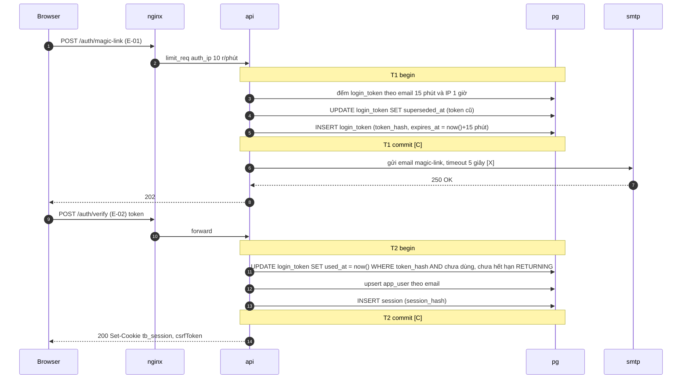

- Gửi SMTP sau commit T1, không qua outbox (DR-21). SMTP lỗi → 503 `EMAIL_PROVIDER_UNAVAILABLE`; token đã lưu thay token cũ, người dùng bấm "Gửi lại".
- T2 là trọng tài của "link dùng một lần": câu `UPDATE … RETURNING` có điều kiện, 50 request song song cùng token chỉ một cái nhận dòng (DOC-19, AU-xx).
- Không có Redis ở luồng này: giới hạn gửi đếm trong PostgreSQL (DR-56). Chi tiết tầng ở DOC-83.

## 3. Giữ vé SEAT + ZONE + GA trong một request (UC-03; FL-13, FL-30, FL-34)

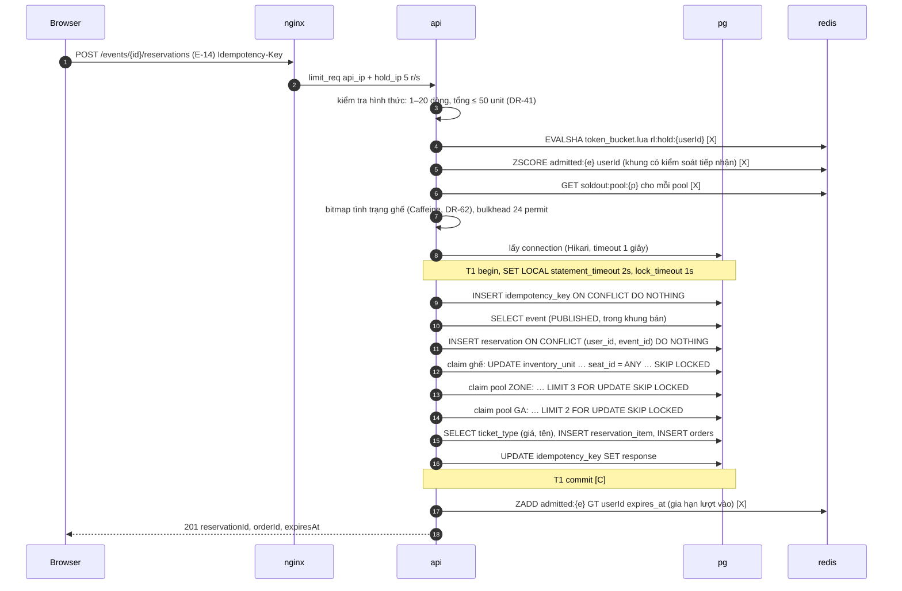

- Mọi kiểm tra Redis chạy **trước** khi lấy connection; Redis lỗi hoặc quá 200 ms thì bỏ qua bước đó (DR-56), trừ sự kiện `high_demand` (503, DR-57). Redis không bao giờ quyết định có bán hay không (ADR-0002).
- Thứ tự câu trong T1 theo DOC-14 §8: `reservation` chèn trước claim. Claim thiếu dòng ở bất kỳ câu nào → T1 rollback, gồm cả dòng `idempotency_key` và `reservation`; response 409 `SEATS_UNAVAILABLE` hoặc `INSUFFICIENT_CAPACITY`. Sau rollback vì thiếu sức chứa, `api` đếm `AVAILABLE` của pool và đặt `soldout:pool:{p}` TTL 30 giây khi bằng 0 (DR-46); việc này nằm ngoài transaction.
- Điểm ack duy nhất với client là response sau T1 commit. Gia hạn lượt vào ở Redis nằm sau commit; mất bước này chỉ làm lượt vào hết hạn sớm, không ảnh hưởng reservation (§13, §14 F2).
- Không có outbox: chưa có tiền, chưa có vé.

## 4. Tạo PaymentIntent với giao thức `FOR SHARE` (UC-04; FL-20; DR-47)

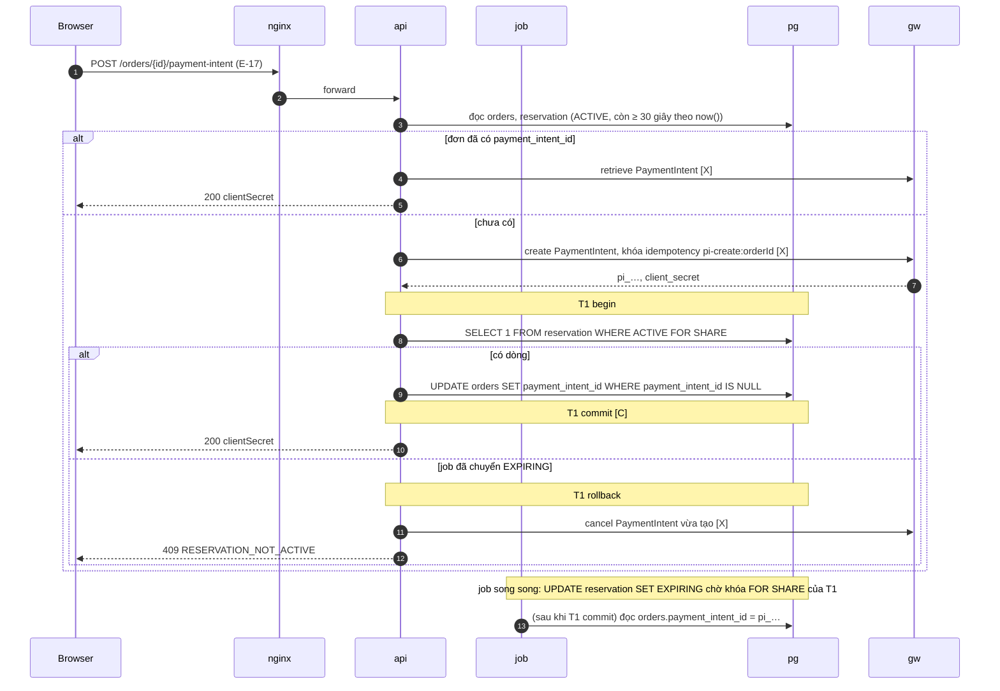

- Khe hở mà giao thức đóng lại: job đặt `EXPIRING` và đọc `payment_intent_id` trong lúc request đã tạo PaymentIntent ở Stripe nhưng chưa lưu ID. `FOR SHARE` trên dòng reservation buộc câu `UPDATE … SET status = 'EXPIRING'` của job chờ T1 commit; khi job đọc `payment_intent_id`, ID đã có, nên job hủy PaymentIntent trước khi trả vé (§6).
- `clientSecret` chỉ về trình duyệt sau T1 commit, nên người mua không thể trả tiền cho một PaymentIntent chưa được lưu (xem ngoại lệ ở §14 F5).
- Gọi Stripe nằm ngoài transaction: connect 2 giây, read 10 giây, tối đa 2 lần thử lại (DR-47).

## 5. Xác nhận qua webhook (UC-04; FL-21; DR-48)

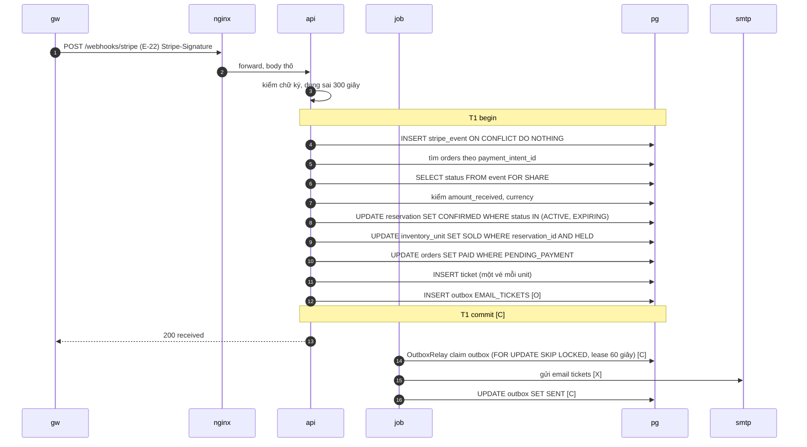

- Ack cho Stripe là 200 sau T1 commit. Mọi lỗi trong T1 → rollback, 500, Stripe gửi lại; `stripe_event` rollback cùng nên lần gửi lại được xử lý như mới (DR-48).
- Gặp lại event đã xử lý: câu `INSERT stripe_event` trả 0 dòng → 200 ngay, không đọc gì thêm.
- Đơn 0 đồng đi cùng T1 (bỏ ba câu đầu, thêm `INSERT idempotency_key` ở đầu) qua `POST /orders/{id}/confirm-free` (E-18) và cũng ghi outbox `EMAIL_TICKETS` (FL-14).
- Email gửi bởi `OutboxRelay` sau commit, ít nhất một lần, `Message-ID` cố định (DR-53). Trình duyệt biết kết quả bằng cách hỏi `GET /orders/{id}` (DR-50), không qua kênh đẩy.

## 6. Job trả vé (UC-11; FL-16, FL-22; DR-42, DR-43)

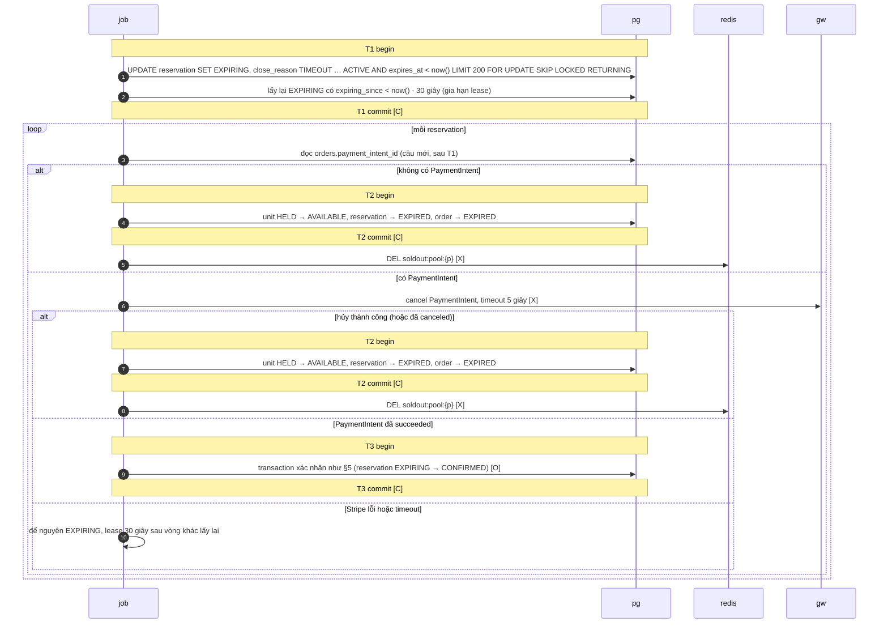

- `EXPIRING` là trọng tài (ADR-0004): T1 rút reservation khỏi `ACTIVE` trước khi gọi Stripe, nên webhook đến trong lúc job đang hủy chỉ có thể xác nhận qua `status IN ('ACTIVE','EXPIRING')`; T2 của job chỉ trả vé với `WHERE status = 'EXPIRING'`. Hai transaction đua nhau, câu thua nhận 0 dòng và dừng.
- Kho vé chỉ được trả **sau** khi PaymentIntent đã hủy chắc chắn (SDD gốc §8.4). Stripe lỗi thì unit vẫn `HELD`; đó là cái giá chấp nhận để không bán vé đã có người trả tiền.
- Cờ hết vé xóa sau commit T2; mất bước này thì cờ tự hết sau 30 giây (DR-46).
- Ở P2 chưa có PaymentIntent nên chỉ chạy nhánh đầu (FL-16); P3 thêm ba nhánh còn lại (FL-22).

## 7. Hủy giữ vé đường nhanh (UC-06; FL-15; DR-43)

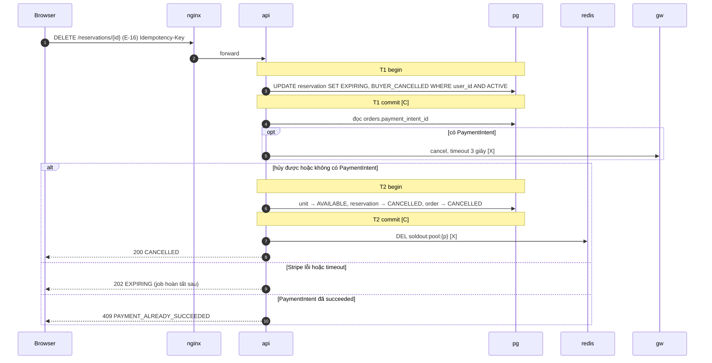

- Đường nhanh dùng đúng thủ tục "trả vé" của job (§6); khác biệt duy nhất là `close_reason` và timeout 3 giây. Tiến trình chết sau T1 commit: reservation ở `EXPIRING`, job lấy lại sau lease 30 giây và hoàn tất; người mua gửi lại cùng key nhận 200 với trạng thái hiện tại.

## 8. Thanh toán đến trễ (UC-15; FL-23; DR-44)

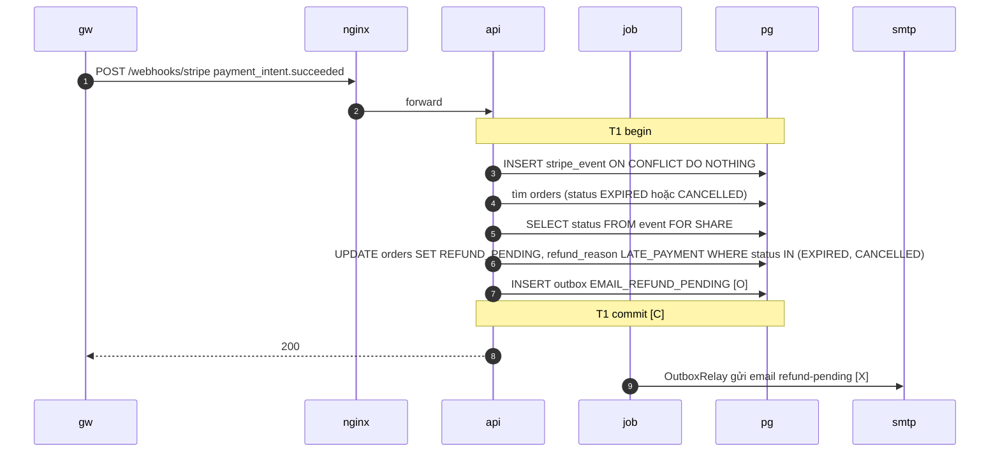

- Không chạm `inventory_unit`, không phát hành vé, kể cả khi chỗ còn trống. Log ERROR mỗi lần: thiết kế ở §4 và §6 làm luồng này hiếm, khác 0 là dấu hiệu cần điều tra.
- Hoàn tiền là việc tay của người vận hành theo RB-01 (`REFUND_PENDING → REFUNDED`), không có luồng dữ liệu tự động tới Stripe.

## 9. Hủy sự kiện đã bán đua với webhook (UC-13; FL-10; DR-28)

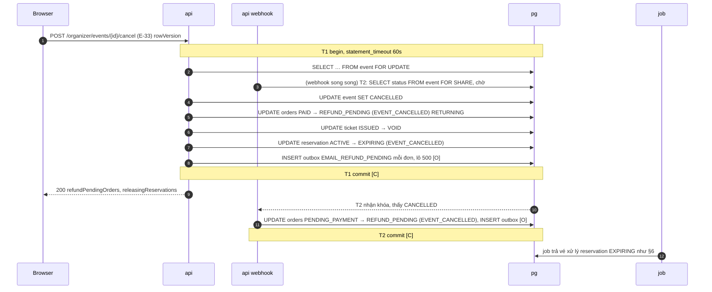

- Hai thứ tự commit có thể xảy ra, cả hai đều đúng:
  - **Hủy commit trước** (sơ đồ trên): webhook chờ khóa `FOR SHARE`, thấy `CANCELLED`, chuyển đơn sang `REFUND_PENDING` mà không phát hành vé.
  - **Xác nhận commit trước**: lệnh hủy chờ `FOR UPDATE` tới khi webhook commit; bước `UPDATE orders … WHERE status = 'PAID'` bắt đơn vừa `PAID`, vé vừa `ISSUED` chuyển `VOID`.
- Khóa nằm trên **một** dòng `event`. `FOR SHARE` chỉ có ở transaction xác nhận, không ở đường giữ vé, nên không tạo hot row cho lệnh giữ vé (DR-28).
- Reservation `ACTIVE` không được trả ngay trong T1: chúng qua `EXPIRING` để job hủy PaymentIntent trước (§6); đơn `PENDING_PAYMENT` của chúng thành `CANCELLED` (DR-91).

## 10. Nhân bản sơ đồ (UC-22; FL-28; DR-31)

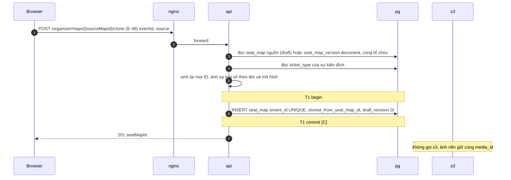

- Một câu ghi duy nhất; trùng `event_id` → 409 `MAP_ALREADY_EXISTS`. Không có kho vé, không có outbox: sơ đồ mới là bản nháp, kho vé chỉ sinh khi xuất bản (§11, §12).
- Ảnh nền là object bất biến nên hai sơ đồ dùng chung `media_id`; không sao chép byte trong storage (DR-31, DR-38).

## 11. Xuất bản sự kiện tạo kho vé (UC-09; FL-08; DR-27)

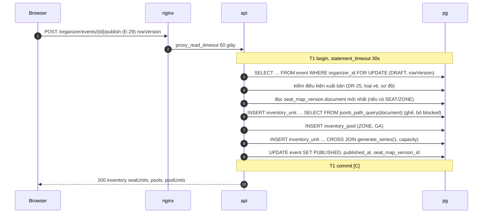

- Sự kiện và toàn bộ kho vé xuất hiện cùng một commit: không có thời điểm nào sự kiện `PUBLISHED` mà thiếu unit. Quá 30 giây → rollback, 503 `OVERLOADED`, thử lại được (không dữ liệu dở).
- Tài liệu sơ đồ đi từ module `map` sang `inventory` dưới dạng tham số `jsonb` của câu `INSERT … SELECT` (DOC-07 §4.3); ở mức container đó vẫn là một round-trip tới `pg`.
- Không có Redis, S3 hay outbox. Mở bán đúng giờ không cần ghi gì: `displayStatus` tính từ `sale_starts_at` (DR-24). Thời gian của T1 với 20.000 ghế + 80.000 unit pool đo ở S-03 (mục tiêu < 5 giây, chưa đo).

## 12. Xuất bản phiên bản sơ đồ khi sự kiện đã xuất bản, trước giờ mở bán (UC-14; FL-31; DR-37)

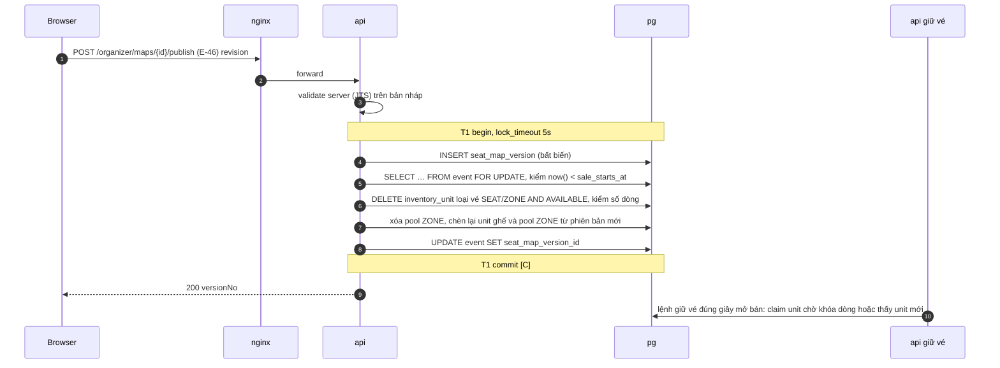

- Trước giờ mở bán không lệnh giữ vé nào thành công (DR-41 bước 2), nên mọi unit `SEAT`/`ZONE` đều `AVAILABLE`. Trường hợp duy nhất còn lại là đua với giây mở bán: số dòng xóa khác tổng unit → rollback, 409 `MAP_LOCKED_AFTER_SALE`; chờ khóa quá 5 giây → 409 `MAP_PUBLISH_BUSY`.
- Phiên bản sơ đồ và kho vé mới commit cùng nhau, nên `seat_index` trong unit luôn khớp phiên bản `event.seat_map_version_id` mà trình xem sơ đồ tải (DR-40, DR-62).
- Từ giờ mở bán, cả `PUT draft` và `publish` trả 409 `MAP_LOCKED_AFTER_SALE` trước khi mở transaction ghi (DR-37). Khi sự kiện còn `DRAFT`, luồng chỉ có `INSERT seat_map_version` (P4), kho vé sinh ở §11.

## 13. Phòng chờ: từ nhóm chờ trước tới giữ vé (UC-12; FL-33, FL-34; DR-57, DR-58, DR-59)

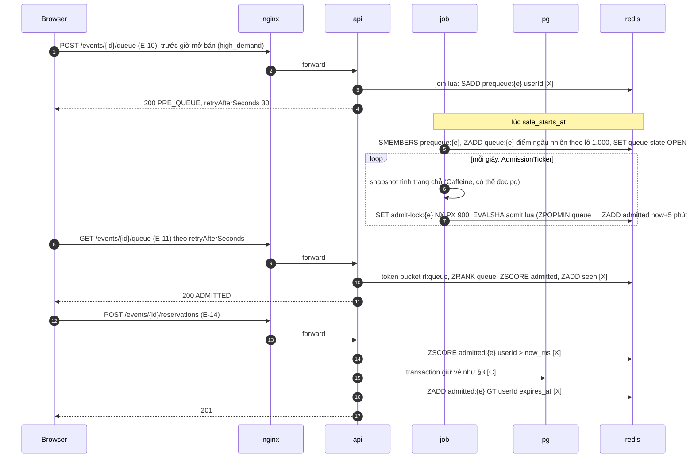

- Toàn bộ trạng thái phòng chờ nằm trong Redis và chỉ là bộ lọc tải; PostgreSQL vẫn là trọng tài cuối ở §3 (ADR-0002). Không có transaction nào bao quanh lệnh Redis.
- `admit.lua` nguyên tử trong Redis; `admit-lock:{e}` bảo đảm một lượt cấp mỗi giây khi có nhiều bản sao `api` (DR-59).
- Sự kiện không `high_demand` bỏ ba bước đầu: `POST /queue` trả `ADMITTED` ngay khi còn chỗ và hàng trống (hàng đợi "trong suốt", DR-57). Rời hàng (`DELETE /events/{id}/queue`, E-12) chỉ xóa key trong Redis.

## 14. Luồng lỗi

### F1. API dừng giữa transaction giữ vé

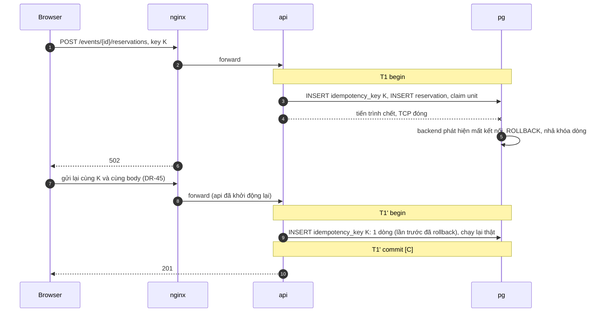

- Không có dòng mồ côi: `idempotency_key`, `reservation`, unit `HELD` đều thuộc T1 nên biến mất cùng rollback. Unit bị khóa dòng được nhả ngay khi PostgreSQL phát hiện socket đóng; tối đa tới `statement_timeout` 2 giây nếu kết nối treo mà không đóng.
- Trong lúc `api` khởi động lại, `nginx` trả 502; frontend tự thử lại với cùng key theo DR-132.

### F2. API dừng sau commit, trước khi gửi response

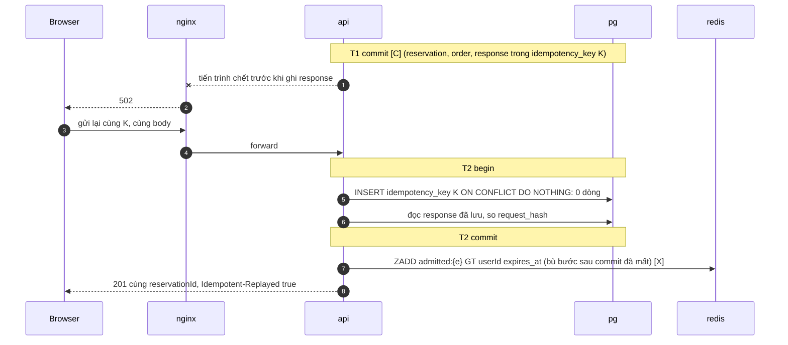

- Đây là lý do response được lưu **trong** T1 (DR-45, DOC-25). Người mua thấy đúng reservation đã giữ, không giữ đôi.
- Bước gia hạn lượt vào sau commit (§3) bị mất cùng tiến trình; lượt phát lại chạy lại bước này (DR-156). Nếu người mua không gửi lại, reservation vẫn đúng; chỉ lượt vào hết hạn theo `pass_ttl` 5 phút, không ảnh hưởng thanh toán.

### F3. Mất kết nối PostgreSQL trong lúc job trả vé chạy

| Điểm mất kết nối | Dữ liệu sau sự cố | Phục hồi |
| --- | --- | --- |
| Trước T1 commit (§6) | T1 rollback: reservation vẫn `ACTIVE` dù quá hạn | Vòng sau (5 giây) chọn lại |
| Sau T1 commit, trước khi gọi Stripe hoặc giữa lúc gọi | Reservation `EXPIRING`, `expiring_since` đã đặt; unit vẫn `HELD` | Hết lease 30 giây, bước (b) của vòng sau lấy lại; gọi hủy PaymentIntent lần hai: PaymentIntent đã `canceled` được coi như hủy thành công |
| Trong T2 (trả vé) | T2 rollback: reservation `EXPIRING`, unit `HELD` | Như dòng trên |
| Sau T2 commit, trước `DEL soldout:pool` | Đã trả vé; cờ hết vé có thể còn | Cờ tự hết sau 30 giây (DR-46) |

- Không bao giờ có unit `AVAILABLE` trong khi PaymentIntent còn có thể thành công: T2 chỉ chạy sau khi hủy đã chắc chắn.
- Mỗi vòng job bị lỗi tăng `ticket_job_runs_total{job="release_expired",result="error"}` (DOC-33). Trễ trả vé thêm tối đa lease 30 giây + một nhịp 5 giây nên NFR-03 (≤ 30 giây) có thể trượt trong lúc mất kết nối; `InvariantChecker` báo reservation `EXPIRING` kẹt quá 2 phút (DR-42). EXP-08 đo kịch bản này.

### F4. Mất Redis khi đang có hàng đợi

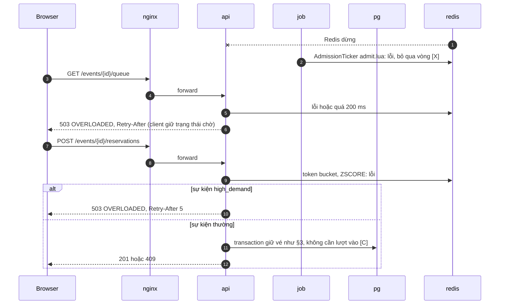

- Tính đúng đắn không đổi: mọi quyết định bán nằm trong PostgreSQL (DR-56, DR-57). Lớp bảo vệ còn lại là `limit_req` của `nginx` và bulkhead 24 permit (DR-61).
- Redis không có volume (DOC-07 §2.2): khi Redis chạy lại, `queue:{e}`, `admitted:{e}` trống. Người đang chờ nhận `NOT_IN_QUEUE` ở lần hỏi kế tiếp và vào lại hàng; thứ tự cũ không được giữ. Hành vi chi tiết của client và của `AdmissionTicker` khi Redis trở lại do DOC-28 và DOC-90 (FL-35) chốt.

### F5. Webhook đến khi `orders.payment_intent_id` chưa được lưu

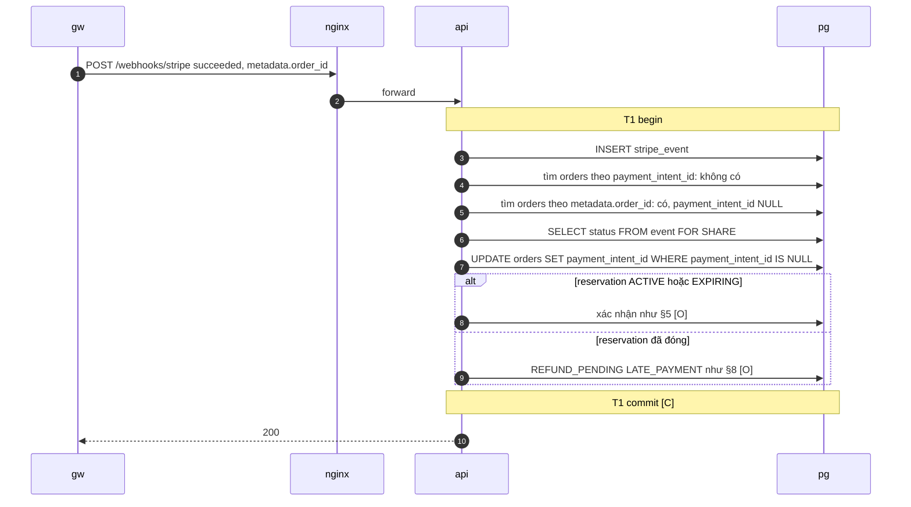

- Trong vận hành bình thường không xảy ra: `clientSecret` chỉ trả về sau khi ID đã lưu (§4). Luồng này phủ ba trường hợp: request tạo PaymentIntent chết sau khi gọi Stripe nhưng trước T1 của §4, rồi người mua gửi lại và Stripe trả cùng PaymentIntent theo khóa `pi-create:<orderId>` trong khi T1 của lần gửi lại chưa commit; cổng giả bơm webhook có chủ đích (EXP-06); `PaymentReconcileJob` gọi cùng handler (DR-49).
- Tra theo `metadata.order_id` là đường dự phòng của DR-48; ghi `payment_intent_id` khi còn NULL (DR-157) giữ cho job trả vé, đối chiếu và RB-03 nhìn thấy PaymentIntent. Transaction xác nhận vẫn dùng trạng thái reservation làm trọng tài nên kết quả đúng dù job đã đọc `payment_intent_id` NULL trước đó: job đã trả vé thì đơn sang `REFUND_PENDING`, không bao giờ có vé không chỗ.

## 15. Bảng tổng hợp điểm commit, gọi ra ngoài và outbox

| § | Luồng | Transaction (commit) | Gọi ra ngoài (sau/trước commit) | Outbox | Ack cho bên gọi |
| --- | --- | --- | --- | --- | --- |
| 2 | Magic link | T1 token; T2 verify | SMTP sau T1 | — | 202 sau SMTP; 200 sau T2 |
| 3 | Giữ vé | T1 (idempotency → reservation → claim → item, order → response) | Redis trước T1 (bucket, `ZSCORE`, cờ); Redis sau T1 (gia hạn lượt) | — | 201 sau T1 |
| 4 | Tạo PaymentIntent | T1 (`FOR SHARE` + lưu ID) | Stripe trước T1; hủy sau rollback | — | 200 sau T1 |
| 5 | Xác nhận webhook | T1 (stripe_event → event `FOR SHARE` → reservation → unit → order → ticket) | SMTP bởi `OutboxRelay` sau T1 | `EMAIL_TICKETS` | 200 sau T1 |
| 6 | Job trả vé | T1 (`ACTIVE → EXPIRING`); T2 (trả vé) hoặc T3 (xác nhận) | Stripe giữa T1 và T2; Redis sau T2 | `EMAIL_TICKETS` ở nhánh T3 | — |
| 7 | Hủy giữ đường nhanh | T1, T2 như §6 | Stripe giữa T1 và T2; Redis sau T2 | — | 200/202 sau T2 hoặc sau Stripe lỗi |
| 8 | Thanh toán trễ | T1 (stripe_event → `REFUND_PENDING`) | SMTP bởi `OutboxRelay` | `EMAIL_REFUND_PENDING` | 200 sau T1 |
| 9 | Hủy sự kiện | T1 (`FOR UPDATE` event, sáu bước) | — | `EMAIL_REFUND_PENDING` mỗi đơn | 200 sau T1 |
| 10 | Nhân bản sơ đồ | T1 (`INSERT seat_map`) | — | — | 201 sau T1 |
| 11 | Xuất bản sự kiện | T1 (event `FOR UPDATE` → unit → pool → event) | — | — | 200 sau T1 |
| 12 | Phiên bản sơ đồ trước mở bán | T1 (version → event `FOR UPDATE` → xóa và dựng lại unit) | — | — | 200 sau T1 |
| 13 | Phòng chờ | Chỉ T1 của §3 | Redis ở mọi bước | — | 200 từ Redis; 201 sau T1 |

Quy tắc chung kiểm được bằng review (DOC-12 §7): không mũi tên `[X]` nào nằm giữa `begin` và `commit`; mọi `[O]` nằm trong transaction đổi trạng thái nghiệp vụ tương ứng.

## 16. Quyết định phát sinh khi viết tài liệu này

**DR-156 · Phát lại idempotent của lệnh giữ vé cũng gia hạn lượt vào.** *Vấn đề:* gia hạn `admitted:{e}` tới `expires_at` chạy sau commit (§3); tiến trình chết giữa commit và bước này (F2) làm lượt vào hết hạn theo `pass_ttl` dù reservation còn hạn. *Quyết định:* khi E-14 trả response đã lưu (`Idempotent-Replayed: true`) với `status = ACTIVE`, `api` chạy lại `ZADD admitted:{e} GT <userId> <expiresAtMs>`; lỗi Redis bị bỏ qua như mọi bước Redis khác. *Hệ quả:* một lệnh Redis thêm ở đường phát lại; `GT` bảo đảm không rút ngắn lượt vào. *Ghi vào:* DOC-08, DOC-25, DOC-28.

**DR-157 · Webhook tìm đơn qua `metadata.order_id` thì ghi `payment_intent_id` khi còn NULL.** *Vấn đề:* DR-48 cho tìm đơn theo `metadata.order_id` khi không thấy theo `payment_intent_id`, nhưng không nói có lưu ID không; thiếu ID thì job trả vé, `PaymentReconcileJob` và RB-03 không thấy PaymentIntent của đơn. *Quyết định:* trong transaction webhook, sau khi tìm đơn theo metadata: `UPDATE orders SET payment_intent_id = :pi WHERE order_id = :o AND payment_intent_id IS NULL`; đơn đã có ID khác → log ERROR, `outcome = IGNORED`, không đổi trạng thái đơn. *Hệ quả:* `orders.payment_intent_id` luôn phản ánh PaymentIntent đã chạm hệ thống; ràng buộc `UNIQUE` của cột bắt trường hợp hai đơn dùng chung một PaymentIntent. *Ghi vào:* DOC-08, DOC-26, DOC-09.

## Câu hỏi còn mở

Không còn. Quyết định phát sinh: DR-156, DR-157 (§16).
