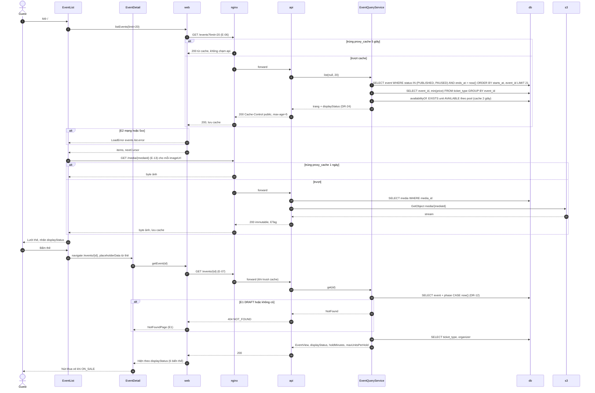
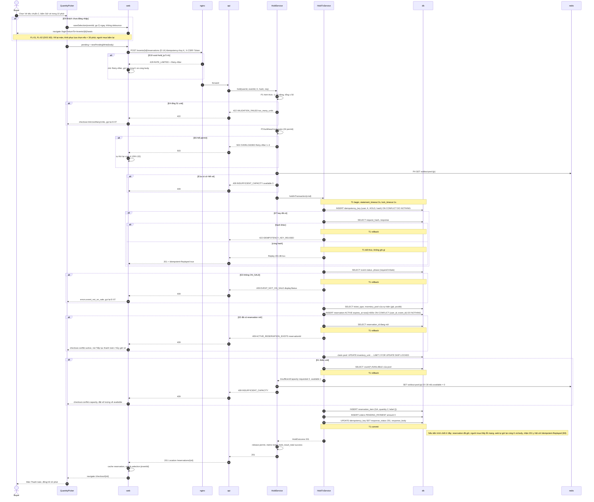
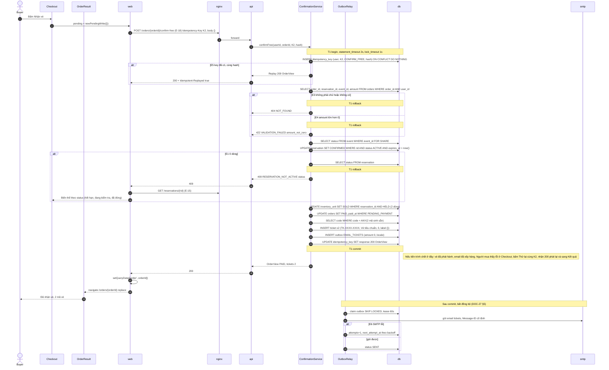
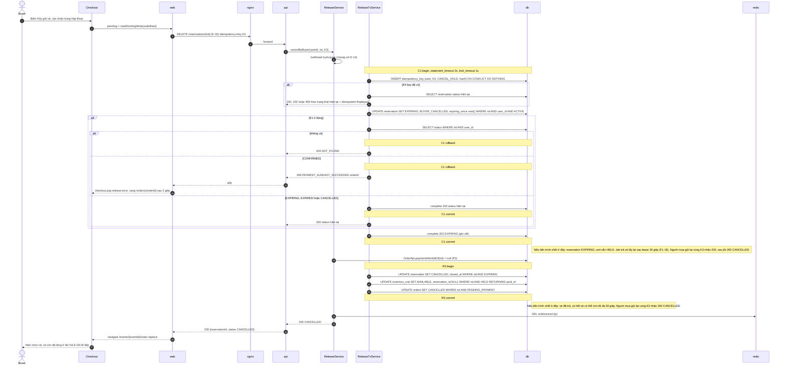
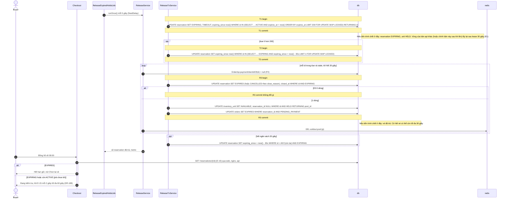
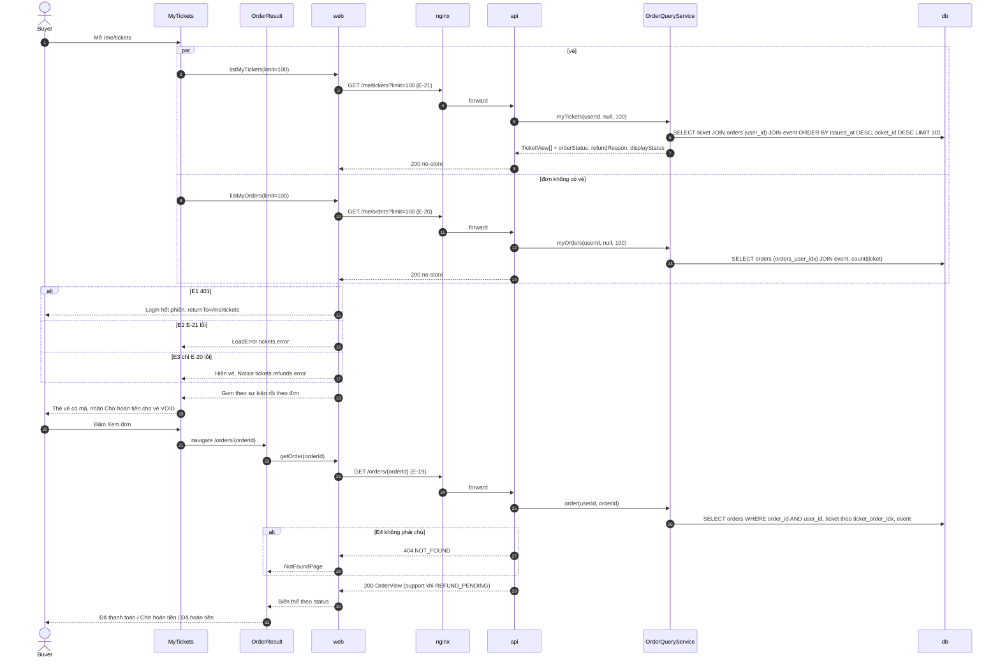

# Luồng: Mua vé GA

> Trạng thái: **Review** · Cập nhật: 2026-10-15 · DOC-85
> Phụ thuộc: [DOC-82](README.md) (tên thành phần tham gia), [DOC-04](../../01-product/use-cases.md) UC-02…06, UC-11, [DOC-08](../../03-architecture/data-flows.md) §3, §6, §7, §14 (F1–F3), [DOC-14](../../05-data/domain-model.md) §4.4, §6.3–6.5, §7, §8, [DOC-15](../../05-data/ops-model.md) §5, §7, [DOC-18](../../05-data/data-lifecycle.md), [DOC-20](../events-and-ticket-types.md) §3.2, §6.7, §6.8, [DOC-24](../inventory-and-reservation.md) §4, §7, [DOC-25](../idempotency.md) §3, §4, [DOC-27](../tickets-and-notifications.md) §4, §5, [DOC-35](../error-handling.md), [DOC-37](../../07-api/api-endpoints.md) (E-06, E-07, E-09, E-13…16, E-18…21), [DOC-40](../../08-ux-ui/ui-states-and-copy.md) §3.5, §4.1, [DOC-42](../../08-ux-ui/screens/event-list.md), [DOC-43](../../08-ux-ui/screens/event-detail.md), [DOC-47](../../08-ux-ui/screens/quantity-picker.md), [DOC-48](../../08-ux-ui/screens/checkout.md), [DOC-49](../../08-ux-ui/screens/order-result.md), [DOC-50](../../08-ux-ui/screens/my-tickets.md), [Sổ quyết định](../../00-decision-register.md) (DR-12, 24, 28, 38, 41, 42, 43, 45, 46, 52, 55, 62, 66, 67, 132, 154, 161, 167, 169, 170, 175, 182, 185, 186, 187, 188, 191), [ADR-0003](../../04-adr/0003-one-row-per-ticket-skip-locked.md), [ADR-0004](../../04-adr/0004-reservation-row-as-arbiter-expiring-state.md)
> Người dùng chính: P2-08 (giữ vé, `confirm-free`, phát hành vé), P2-09 (job trả vé, hủy giữ đường nhanh), P2-10 (giao diện mua vé GA), P2-07 (idempotency), tác giả DOC-87 (FL-20…23 dùng lại các bước của FL-13…16), người viết test E2E mua vé GA

Tài liệu mô tả sáu luồng chi tiết `FL-12…17` của người mua với sự kiện **chỉ có loại vé `GA`**: xem sự kiện, giữ vé, nhận vé đơn 0 đồng, hủy giữ vé, job trả vé khi hết hạn và xem vé của tôi. Mỗi luồng đi qua từng tầng (màn hình, `web`, `nginx`, controller, service, câu SQL), nêu ranh giới transaction và người dùng thấy gì nếu tiến trình chết sau mỗi commit.

**Ranh giới.** Điểm commit ở mức container nằm ở DOC-08; tài liệu này dẫn ngược về đó và không vẽ lại. Câu SQL đầy đủ của giữ vé và trả vé ở DOC-24 §4, giao thức idempotency ở DOC-25 §3, phát hành vé và outbox ở DOC-27 §4–§5, `displayStatus` ở DOC-20 §3.2; payload ở DOC-37; chuỗi giao diện ở DOC-40. Ở đây chỉ trích câu ngắn đủ để đọc sơ đồ. Ghế và khu vực (FL-29, FL-30) ở DOC-89; thanh toán bằng thẻ và nhánh có PaymentIntent của job trả vé (FL-20…22) ở DOC-87; phòng chờ (FL-33, FL-34) ở DOC-90.

Mọi quyết định mới phát sinh khi viết tài liệu này được ghi thành DR-222…224 và tóm tắt ở mục "Quyết định mới khi viết tài liệu này".

Mọi sơ đồ dùng tên thành phần của DOC-82 §1. Thành phần cụ thể của file này:

| Tên | Loại | Mã | Ghi chú |
| --- | --- | --- | --- |
| `EventList`, `EventDetail` | Màn hình | `frontend/src/features/events/EventList.tsx`, `EventDetail.tsx` | DOC-42, DOC-43 |
| `QuantityPicker` | Màn hình | `frontend/src/features/purchase/QuantityPicker.tsx` | DOC-47; `SeatsRoute` chọn màn này khi `hasSeatMap = false` (DOC-41 §3) |
| `Checkout`, `OrderResult` | Màn hình | `frontend/src/features/purchase/Checkout.tsx`, `OrderResult.tsx` | DOC-48, DOC-49 |
| `MyTickets` | Màn hình | `frontend/src/features/tickets/MyTickets.tsx` | DOC-50 |
| `web` | SPA | `src/api/apiClient.ts`, `src/lib/idempotency.ts`, `src/lib/selection.ts` | `X-Server-Time`, `Idempotency-Key`, CSRF, tự thử lại (DR-132), lựa chọn qua đăng nhập (DR-67) |
| `api` | API | `event.controller.EventController`, `media.controller.MediaController`, `inventory.controller.AvailabilityController`, `reservation.controller.ReservationController`, `payment.controller.OrderController` | Module theo cột "Module" của DOC-37 §2 |
| `EventQueryService` | Service | `io.ticket.event.service.EventQueryService` | E-06, E-07 (DOC-20 §6.7) |
| `HoldService`, `HoldTxService` | Service | `io.ticket.reservation.service` | Điều phối không transaction và transaction giữ vé (DR-167, DOC-24 §3) |
| `ReleaseService`, `ReleaseTxService` | Service | `io.ticket.reservation.service` | Thủ tục trả vé dùng chung (DR-43, DOC-24 §4.4) |
| `ConfirmationService` | Service | `io.ticket.payment.service.ConfirmationService` | Transaction xác nhận, dùng cho `confirm-free` ở P2 (DOC-27 §4) |
| `OrderQueryService` | Service | `io.ticket.payment.service.OrderQueryService` | E-19…21, chỉ đọc (DR-224) |
| `ReleaseExpiredHoldsJob` | Job | `io.ticket.reservation.job.ReleaseExpiredHoldsJob` | Job trả vé (DR-154) |
| `OutboxRelay` | Job | `io.ticket.notification.job.OutboxRelay` | Gửi `EMAIL_TICKETS` sau commit (DOC-27 §5.2) |

Dữ liệu mẫu dùng chung trong các bảng bước: sự kiện GA 0 đồng "Hội thảo Kiến trúc Hệ thống" `eventId = 0199b1c2-7a3e-7c40-8f11-2d5e9a6b0c34`, loại vé "Vé tiêu chuẩn" `ticketTypeId = 0199b1c2-7b01-7f10-8a22-3c4d5e6f7081` giá 0, pool `poolId = 0199b1c2-5002-7aaa-8bbb-111122223334` sức chứa 300 (theo ví dụ của DOC-37 E-06 và DOC-25 §3.4). Với ví dụ có tiền dùng sự kiện seed "Hội thảo Nghề Thiết Kế" (DR-78): Phổ thông 450.000 ₫, Sinh viên 250.000 ₫, Đặt sớm đã hết.

## FL-12 · Xem danh sách và chi tiết sự kiện

- **UC / FR:** UC-02, FR-05 · **Màn hình:** `EventList` ([DOC-42](../../08-ux-ui/screens/event-list.md)), `EventDetail` ([DOC-43](../../08-ux-ui/screens/event-detail.md)) · **Endpoint:** `GET /events` (E-06), `GET /events/{eventId}` (E-07), `GET /media/{mediaId}` (E-13) · **Sự kiện:** không
- **Trigger:** khách hoặc người mua mở `/` hoặc `/events/{eventId}`; bấm một thẻ sự kiện.
- **Điều kiện đầu:** không cần đăng nhập. Sự kiện `DRAFT` không bao giờ hiện (E-07 trả 404).

### Thành phần

| Tên | Loại | Mã | Định nghĩa ở |
| --- | --- | --- | --- |
| `EventList`, `EventDetail` | Màn hình | `useInfiniteQuery(['events'])`, `useQuery(['event', id])` | DOC-42 §5, DOC-43 §5 |
| `web` | SPA | `apiClient` (đọc không CSRF) | DOC-12 §6 |
| `nginx` | Edge | `proxy_cache` 5 giây cho E-06, E-07; `proxy_cache` 1 ngày cho `/media/`; `limit_req api_ip` 20 r/s burst 40 | DR-55, DR-86, DR-38, DOC-62 §8 |
| `api` | API | `EventController.list`, `EventController.get`, `MediaController.get` | DOC-37 E-06, E-07, E-13 |
| `EventQueryService` | Service | `list(cursor, limit)`, `get(eventId)` (`@Transactional(readOnly = true)`) | DOC-20 §6.7 |
| `InventoryApi` | API module | `availabilityOf(eventIds)` (Caffeine 2 giây) | DOC-20 §3.2, DR-161 |
| `db` | Cơ sở dữ liệu | `event`, `ticket_type`, `inventory_pool`, `inventory_unit`, `organizer`, `media` | DOC-14 |
| `s3` | Object storage | `media/<media_id>` | ADR-0015 |

### Sơ đồ tuần tự



Ba khối `alt` của cache đọc giống nhau; sơ đồ chỉ vẽ đủ cho E-06 và E-13. E-07 trượt cache đi qua cùng các bước của E-06 cộng câu `ticket_type` và `organizer`.

### Chi tiết bước

| Bước | Từ → Đến | Lệnh | Dữ liệu | Quy tắc | Lỗi → xử lý |
| --- | --- | --- | --- | --- | --- |
| 3 | `web` → `nginx` | `GET /events?limit=20` | khóa cache gồm query và `Accept-Language` (`Vary`) | DR-86; không cookie session trong khóa | 429 `RATE_LIMITED` → tự thử lại (DR-132) |
| 7 | `EventQueryService` → `db` | keyset `(starts_at, event_id) > (:k, :id)` | `event_public_idx` | chỉ `PUBLISHED`/`PAUSED` còn `ends_at > now()` (DOC-20 §6.7) | — |
| 9 | → `InventoryApi` | `availabilityOf([...20 eventId])` | một câu `EXISTS` cho cả trang | DR-161: `ON_SALE ↔ SOLD_OUT` trễ tối đa 2 giây + 5 giây cache nginx | — |
| 10 | `EventQueryService` | tính `displayStatus` | `phase` từ SQL, tình trạng từ bước 9 | DR-24; Java không gọi `Instant.now()` cho khung bán (DR-12) | — |
| 15 | `EventList` → `nginx` | `GET /media/0199b1c2-1111-7aaa-8bbb-ccccddddeeee` | ảnh ≤ 2 MB | `Cache-Control: public, max-age=31536000, immutable` (DR-38); không qua `apiClient` | 404 → khung ảnh thay bằng tem ngày (DOC-42 §4) |
| 18–19 | `api` → `s3` | `GetObject` | `object_key = media/<media_id>` | stream, không đệm cả ảnh (DOC-37 E-13) | `s3` lỗi → 503, ảnh không hiện, thẻ vẫn hiện |
| 27 | `EventQueryService` → `db` | `SELECT … CASE WHEN now() < sale_starts_at …` | `phase` | DOC-20 §3.2 bước 1 | E1 |
| 30 | `api` → `web` | 200 `EventView` | `holdMinutes = 10`, `maxUnitsPerHold = 50` (DR-187) | `CANCELLED`/`ENDED` vẫn 200 (DR-24) | — |

### Giao dịch và đồng thời

- Không có transaction ghi. `EventQueryService` chạy `readOnly`; đọc `event` không khóa.
- `displayStatus` chỉ là gợi ý (UXP-02 của DOC-38): một sự kiện vừa `SOLD_OUT` có thể còn hiện `ON_SALE` tới ~7 giây (2 giây Caffeine + 5 giây nginx). Lệnh giữ vé (FL-13) mới là kết quả thật.
- `EventDetail` hỏi lại E-07 mỗi 30 giây khi `ON_SALE`/`SOLD_OUT`, và mỗi 2 giây × 10 lần khi đồng hồ "Mở bán sau" về 0 (DOC-43 §5). Mọi lần hỏi trúng cache nginx nên `api` nhận tối đa một request mỗi 5 giây mỗi sự kiện, bất kể số người xem.
- Nhiều bản `api`: mỗi bản có Caffeine riêng; hai bản có thể trả `displayStatus` khác nhau trong ≤ 2 giây. Chấp nhận vì là gợi ý.
- Không có commit nên không có dòng "Nếu tiến trình chết": request lỗi thì client thử lại (đọc idempotent).

### Luồng lỗi

| Mã | Tình huống | Bước | HTTP / `code` | Giao diện |
| --- | --- | --- | --- | --- |
| E1 | Sự kiện `DRAFT`, không tồn tại, hoặc `eventId` sai định dạng | 27 | 404 `NOT_FOUND` | `NotFoundPage` (E1, DOC-52) |
| E2 | Mạng hoặc 5xx khi đọc E-06/E-07 | 3, 23 | không có response hoặc 5xx | Tự thử lại theo DR-132; hết lượt → `LoadError` `events.list.error.*` / `events.detail.error.*` |
| E3 | nginx `api_ip` vượt 20 r/s | 4 | 429 `RATE_LIMITED` + `Retry-After` | Tự thử lại; người dùng thấy khung chờ, không thấy lỗi |
| E4 | Ảnh lỗi (404, `s3` lỗi) | 15–20 | 404 / 503 | Thẻ hiện tem ngày thay ảnh (DOC-42 §4); trang chi tiết bỏ khối ảnh |
| E5 | Danh sách rỗng | 9 | 200 `items: []` | `events.list.empty.*` |

### Test bắt buộc

| ID | Kịch bản | Kỳ vọng |
| --- | --- | --- |
| FLG-01 | Seed 3 sự kiện: `PUBLISHED` đang bán, `PAUSED`, `DRAFT`; `GET /events` | 2 phần tử, `displayStatus` `ON_SALE` và `PAUSED`; không có `DRAFT` |
| FLG-02 | `GET /events/{id}` của sự kiện `DRAFT` | 404 `NOT_FOUND` |
| FLG-03 | Sự kiện có `sale_starts_at = now() + 1 giờ` | `displayStatus = UPCOMING`, `saleStartsAt` đúng |
| FLG-04 | Pool 2 vé, giữ hết 2 vé (FL-13), chờ 2 giây, gọi E-07 không qua nginx | `displayStatus = SOLD_OUT`, `ticketTypes[0].soldOut = true`; trả 2 vé (FL-15), chờ 2 giây → `ON_SALE` |
| FLG-05 | Gọi E-06 hai lần trong 5 giây qua `nginx` | Lần 2 có `X-Cache-Status: HIT`; log `api` chỉ có 1 request |
| FLG-06 | Tải ảnh qua `nginx`, gọi lại | Lần 1 `MISS`, lần 2 `HIT`; header `Cache-Control: public, max-age=31536000, immutable`; `If-None-Match` trùng → 304 |
| FLG-07 | 25 sự kiện đang bán; `GET /events?limit=20` rồi theo `nextCursor` | 20 + 5 phần tử, không trùng, thứ tự `(startsAt, eventId)` tăng dần |
| FLG-08 | E2E: khách mở `/`, bấm thẻ "Hội thảo Kiến trúc Hệ thống" | Trang sự kiện hiện ngay tên từ `placeholderData`; nút "Mua vé" hiện khi `ON_SALE`; chạy `vi` và `en` |

## FL-13 · Giữ vé GA

- **UC / FR:** UC-03, FR-06, FR-07, FR-08 · **Màn hình:** `QuantityPicker` ([DOC-47](../../08-ux-ui/screens/quantity-picker.md)), `Login` (DOC-44, khi chưa đăng nhập), `Checkout` (DOC-48, đích) · **Endpoint:** `GET /events/{eventId}` (E-07), `GET /events/{eventId}/availability` (E-09), `POST /events/{eventId}/reservations` (E-14) · **Sự kiện:** không
- **Trigger:** người mua bấm "Giữ vé trong {minutes} phút" ở `QuantityPicker` sau khi chọn số lượng.
- **Điều kiện đầu:** sự kiện `ON_SALE` (đã xuất bản, trong khung bán); người mua không có reservation `ACTIVE`/`EXPIRING` khác ở sự kiện này. Khách được xem và chọn; giữ vé cần đăng nhập (DR-186).

### Thành phần

| Tên | Loại | Mã | Định nghĩa ở |
| --- | --- | --- | --- |
| `QuantityPicker` | Màn hình | `QuantityPicker.tsx`; `QuantityStepper` | DOC-47 |
| `web` | SPA | `selection.ts` (`tb.selection.<eventId>`), `newPendingWrite()`, `apiClient` | DR-67, DOC-25 §3.6 |
| `nginx` | Edge | `limit_req hold_ip` 5 r/s burst 10 + `api_ip` | DR-55 |
| `api` | API | `ReservationController.create` | DOC-37 E-14 |
| `HoldService` | Service | `hold(userId, eventId, idem, req)` (không transaction) | DOC-24 §4.1 P1–P4 |
| `HoldTxService` | Service | `holdInTransaction(cmd)` (`@Transactional`) | DOC-24 §4.1 T0–T8 |
| `db` | Cơ sở dữ liệu | `idempotency_key`, `event`, `ticket_type`, `inventory_pool`, `reservation`, `inventory_unit`, `reservation_item`, `orders` | DOC-14 §4.4, DOC-15 §5 |
| `redis` | Redis | `soldout:pool:{poolId}` | DR-46 |

### Sơ đồ tuần tự



### Chi tiết bước

| Bước | Từ → Đến | Lệnh | Dữ liệu | Quy tắc | Lỗi → xử lý |
| --- | --- | --- | --- | --- | --- |
| 2–4 | `QuantityPicker` → `web` | `saveSelection` | `localStorage["tb.selection.0199b1c2-…0c34"] = {"seatIds":[],"zones":{},"ga":{"0199b1c2-…7081":2},"savedAt":1762743600000}` | Khôi phục khi `Date.now() − savedAt < 30 phút`, rồi xóa khóa (DR-67, DOC-47 §5); **không** tự gửi lệnh giữ sau đăng nhập (DR-186) | E9 |
| 5 | `web` | `newPendingWrite({items:[…]})` | `{ key: "5d1c9a7e-2b44-4f0a-9c3e-7a1b2c3d4e5f", body: "{\"items\":[{\"type\":\"GA\",\"ticketTypeId\":\"0199b1c2-7b01-7f10-8a22-3c4d5e6f7081\",\"quantity\":2}]}" }` | Một lần bấm = một cặp `(key, body)`; mọi lần thử lại gửi đúng byte đó (DR-45, DOC-25 §3.6) | — |
| 6 | `web` → `nginx` | `POST /api/v1/events/{id}/reservations` | header `Idempotency-Key`, `X-CSRF-Token`, cookie `tb_session` | thiếu key → 400 `IDEMPOTENCY_KEY_REQUIRED` (lỗi lập trình) | E10 |
| 11 | `HoldService` | P1 `HoldRequestValidator` | Σ `quantity` ≤ `maxUnitsPerHold` (50) | không lấy connection khi 422 (INVT-04) | E4 |
| 16 | `HoldService` | `Semaphore.tryAcquire()` | `hold.bulkhead.permits = 24`, chờ 0 | DR-61 | E6 |
| 21 | `HoldService` → `redis` | `GET soldout:pool:0199b1c2-…3334` | `poolIdByTicketType` (Caffeine 60 giây) | Redis lỗi hoặc quá `spring.data.redis.timeout` → bỏ qua (DR-46) | E1a |
| 26 | `HoldTxService` → `db` | `SELECT set_config('statement_timeout','2000',true), set_config('lock_timeout','1000',true)`; `INSERT INTO idempotency_key … ON CONFLICT (user_id, idem_key) DO NOTHING` | `operation = 'HOLD'`, `request_hash = SHA-256(METHOD ‖ path ‖ body thô)` | câu ghi đầu tiên (DR-45, DOC-25 §3.2) | E7 |
| 37 | → `db` | `EventApi.requireOnSale` | `status = 'PUBLISHED'` và `sale_starts_at ≤ now() < sale_ends_at` | đọc không khóa (DOC-24 §7.2 dòng cuối) | E3 |
| 44 | → `db` | `EventApi.ticketTypes`, `InventoryApi.poolsOf` | `price = 0`, `poolId` | giá đọc trong transaction (DR-30); `ticketTypeId` không phải `GA` → 422 `wrong_model`; không thuộc sự kiện → 422 `unknown_reference` | E5 |
| 45 | → `db` | `INSERT INTO reservation … ON CONFLICT (user_id, event_id) WHERE status IN ('ACTIVE','EXPIRING') DO NOTHING RETURNING expires_at` | `reservation_id` UUIDv7 sinh ở Java; `expires_at = now() + 600 giây` theo giờ DB (DR-12) | **trước** claim (DOC-14 §8) | E2 |
| 53 | → `db` | claim pool (DOC-24 §4.2) | `:pool = 0199b1c2-…3334`, `:qty = 2`, `:rid` | `FOR UPDATE SKIP LOCKED`, không chờ khóa unit (ADR-0003) | E1 |
| 63–64 | → `db` | `INSERT reservation_item`; `OrderApi.createPending` | `kind = 'GA'`, `quantity = 2`, `unit_price = 0`, `label = '{}'`; `orders.amount = 0` | đơn 0 đồng vẫn tạo `PENDING_PAYMENT` (DR-41); client gọi E-18 ở FL-14 | — |
| 65 | → `db` | `UPDATE idempotency_key SET response_status = 201, response_body = …` | body 201 như ví dụ DOC-25 §3.4 | câu cuối trước commit (DOC-25 §3.3) | — |
| 71 | `api` → `web` | 201 + `Location` | `{"reservationId":"0199b1c2-8d14-…8091","orderId":"0199b1c2-8d15-…5162","status":"ACTIVE","expiresAt":"2026-11-10T03:10:00.000Z","amount":0,…}` | `X-Server-Time` cho đồng hồ (DR-66) | — |
| 72 | `web` | `queryClient.setQueryData(['reservation', rid], …)`; `removeSelection(eventId)` | — | `Checkout` dùng cache, không gọi E-15 lần đầu (DOC-48 §5) | — |

Thứ tự câu trong T1 là thứ tự bắt buộc của DR-41 và DOC-14 §8: **idempotency → (đọc event, loại vé) → reservation → claim `SKIP LOCKED` → item, đơn → điền response**. Hai câu đọc ở giữa không khóa dòng nào.

### Giao dịch và đồng thời

- **T1** (DOC-24 §7.1): dòng `idempotency_key`, `reservation`, unit `HELD`, `reservation_item`, đơn `PENDING_PAYMENT` và response commit cùng nhau. Không có lời gọi Redis, Stripe hay SMTP trong T1; Redis chỉ ở P4 (trước) và cờ hết vé (sau rollback). Điểm commit ở mức container: DOC-08 §3.
- **Tranh pool:** N lệnh cùng pool khóa các dòng khác nhau nhờ `SKIP LOCKED`; gần hết vé một lệnh có thể bị từ chối oan khi unit cuối đang bị lệnh khác khóa rồi rollback (SDD gốc 8.2). Không bao giờ bán vượt: không thể claim dòng không tồn tại (ADR-0003, INVT-02).
- **Cùng người, hai tab, hai key:** `reservation_open_uq` tuần tự hóa; tab sau chờ tối đa `lock_timeout` 1 giây rồi nhận 409 `ACTIVE_RESERVATION_EXISTS` (khi tab trước commit) hoặc chèn được (khi tab trước rollback); chờ quá 1 giây → 503 `OVERLOADED` (DOC-24 §4.1.1).
- **Cùng key gửi song song** (bấm đúp không xảy ra vì nút khóa khi chờ; trùng lặp đến từ tự thử lại khi mạng chập chờn): request sau chờ trên khóa của dòng key; request trước commit → request sau phát lại 201; request trước rollback → request sau chạy thật (DOC-25 §4.1). Kết quả: đúng một reservation.
- **Sự kiện bị tạm dừng hoặc hủy giữa chừng:** T1 đọc `event` không khóa. Lệnh giữ commit ngay trước lệnh tạm dừng vẫn hợp lệ (người mua thanh toán được, DR-24); lệnh giữ commit ngay trước lệnh hủy bị bước 6 của DR-28 chuyển sang `EXPIRING` rồi trả vé (FL-10, DOC-84).
- **Nếu tiến trình chết** (DOC-24 §7.3, DOC-08 §14 F1–F2):

| Chết ở | Người mua thấy | Gửi lại cùng key |
| --- | --- | --- |
| Trong T1 (bước 26–65) | Lỗi mạng (502 từ `nginx`) | PostgreSQL rollback khi socket đóng; lần gửi lại chạy thật như lần đầu (F1) |
| Sau commit T1, trước response (bước 66–70) | Lỗi mạng | 201 y hệt, `Idempotent-Replayed: true`; cùng `reservationId` (F2, IDEM-04) |
| Sau response, trước `navigate` (tab bị đóng) | Không thấy gì | Không gửi lại: `PendingWrite` mất. Lần bấm sau là key mới → 409 `ACTIVE_RESERVATION_EXISTS` kèm `reservationId`, "Tiếp tục thanh toán" đưa tới đúng reservation (DOC-25 §3.6) |

- Log: INFO `reservation.hold.created` (`reservation_id`, `event_id`, `units`, `amount`) hoặc `reservation.hold.rejected` (`event_id`, `code`); metric `ticket_hold_duration_seconds{model="GA"}`, `ticket_hold_result_total{result}` (DOC-24 §9).

### Luồng lỗi

| Mã | Tình huống | Bước | HTTP / `code` | Giao diện |
| --- | --- | --- | --- | --- |
| E1 | Pool không đủ unit `AVAILABLE` | 53 | 409 `INSUFFICIENT_CAPACITY` `{poolId, requested: 2, available: 1}` | `Notice` `error` `checkout.conflict.title` + `checkout.conflict.capacity` ("còn 1, bạn chọn 2"); số lượng loại đó đặt về 1 (0 → "Đã bán hết"); gọi lại E-09 ngay; **không** tự giữ lại (DOC-47 §6) |
| E1a | Cờ `soldout:pool:{p}` có trong Redis | 21 | 409 `INSUFFICIENT_CAPACITY` `available: 0`, không chạm DB | Như E1 với "Đã bán hết" |
| E2 | Người mua đã có reservation `ACTIVE`/`EXPIRING` ở sự kiện này | 45 | 409 `ACTIVE_RESERVATION_EXISTS` `{reservationId}` | `Notice` `warning` `checkout.conflict.active.*`: "Tiếp tục thanh toán" → `/checkout/{reservationId}`; "Hủy giữ vé" → FL-15 rồi người mua bấm giữ lại với key mới |
| E3 | Sự kiện không `ON_SALE` (`PAUSED`, `SALE_CLOSED`, `UPCOMING`, `CANCELLED`) | 37 | 409 `EVENT_NOT_ON_SALE` `{displayStatus, saleStartsAt?}` | `errors.event_not_on_sale.*`; gọi lại E-07; nút chính vô hiệu khi `displayStatus ≠ ON_SALE` |
| E4 | Tổng 51 unit (client sai hoặc trần đổi ở server) | 11 | 422 `VALIDATION_FAILED` `rule=too_many_units`, `params.max = 50` | `checkout.limit.tooManyUnits`; gọi lại E-07 để lấy `maxUnitsPerHold` mới |
| E5 | `ticketTypeId` không phải `GA` hoặc không thuộc sự kiện (loại vé vừa bị xóa) | 44 | 422 `wrong_model` / `unknown_reference` | `errors.generic`; gọi lại E-07, bỏ loại không còn |
| E6 | Hết permit bulkhead, Hikari hết connection, `statement_timeout` hoặc `lock_timeout` | 16, 26–65 | 503 `OVERLOADED` + `Retry-After` 1–3 giây | `checkout.busy.*` với đếm ngược; tự thử lại cùng key và body (DR-132), tối đa 10 lần rồi nút `common.retry` |
| E7 | Cùng key, body khác | 27 | 422 `IDEMPOTENCY_KEY_REUSED` | Lỗi lập trình: `console.error` kèm `requestId`, `errors.generic`, bỏ `PendingWrite` |
| E8 | Mất mạng giữa client và server (trước hoặc sau commit) | 6–71 | không có response / 502 | `checkout.busy.*`; tự gửi lại cùng key: nhận 201 thật hoặc 201 phát lại (`Idempotent-Replayed: true`), xử lý như nhau |
| E9 | Khách chưa đăng nhập | 2 | không gọi API | Lưu lựa chọn, `/login?returnTo=%2Fevents%2F{id}%2Fseats`; sau đăng nhập lựa chọn còn nguyên (UX-10) |
| E10 | nginx `hold_ip` vượt 5 r/s (burst 10) | 7 | 429 `RATE_LIMITED` + `Retry-After` | `errors.rate_limited.*`, tự thử lại cùng key |
| E11 | Phiên hết khi bấm giữ vé | 6 | 401 `UNAUTHENTICATED` | Ghi lựa chọn, `Login` biến thể hết phiên với `returnTo` (FL-03) |

### Test bắt buộc

| ID | Kịch bản | Kỳ vọng |
| --- | --- | --- |
| FLG-10 | Pool 300 vé giá 0; `POST` E-14 `{GA, quantity 2}` với key mới | 201; 1 `reservation` `ACTIVE`, `expires_at − created_at = 600 ± 1 giây`; 2 unit `HELD` cùng `reservation_id`; 1 `reservation_item` `label = {}`; đơn `PENDING_PAYMENT` `amount = 0`; dòng `idempotency_key` có `response_status = 201` |
| FLG-11 | Gửi lại FLG-10 cùng key, cùng byte body | 201, `Idempotent-Replayed: true`, body bằng nhau về JSON; vẫn 2 unit `HELD`, 1 reservation |
| FLG-12 | Cùng key, `quantity` 3 | 422 `IDEMPOTENCY_KEY_REUSED`; không đổi gì |
| FLG-13 | 20 request song song cùng key, cùng body | 1 reservation; 20 response 201 bằng nhau về JSON; 19 có `Idempotent-Replayed: true` (khớp P2-07) |
| FLG-14 | Người mua có reservation `ACTIVE`; giữ lần nữa với key mới | 409 `ACTIVE_RESERVATION_EXISTS`, `reservationId` đúng; 0 unit mới `HELD`; không dòng `idempotency_key` mới |
| FLG-15 | Pool còn 1 vé; xin 2 | 409 `INSUFFICIENT_CAPACITY` `requested 2`, `available 1`; không dòng `reservation`, `orders`, `idempotency_key` mới |
| FLG-16 | Pool còn 0 vé; xin 1 hai lần | Lần 1: 409 `available 0` và có khóa `soldout:pool:{p}` TTL ≤ 30 giây; lần 2: 409 mà không có câu SQL nào (đếm bằng `pg_stat_statements` hoặc log SQL) |
| FLG-17 | Sự kiện `PAUSED` | 409 `EVENT_NOT_ON_SALE` `displayStatus PAUSED` |
| FLG-18 | `quantity = 51` | 422 `too_many_units` `params.max = 50`; `quantity = 50` → 201 |
| FLG-19 | Ngắt `api` (dừng container) ngay sau commit T1 bằng breakpoint test; client gửi lại cùng key sau khi `api` lên | 201 cùng `reservationId`, `Idempotent-Replayed: true`; đúng 1 reservation |
| FLG-20 | E2E: khách mở "Hội thảo Kiến trúc Hệ thống", chọn 2 vé, bấm giữ vé, đăng nhập qua Mailpit | Về `/events/{id}/seats` với 2 vé đã chọn; bấm giữ vé → `/checkout/{reservationId}`; khóa `tb.selection.<eventId>` bị xóa (khớp P2-10) |
| FLG-21 | E2E mock: E-14 trả 503 `Retry-After: 2` rồi 201 | Lần gọi 2 sau 2 giây có cùng `Idempotency-Key` và cùng body từng byte; điều hướng sau 201 |

## FL-14 · Nhận vé đơn 0 đồng

- **UC / FR:** UC-04 (nhánh 0 đồng), UC-05, FR-09, FR-10 · **Màn hình:** `Checkout` ([DOC-48](../../08-ux-ui/screens/checkout.md)), `OrderResult` ([DOC-49](../../08-ux-ui/screens/order-result.md)) · **Endpoint:** `GET /reservations/{reservationId}` (E-15), `POST /orders/{orderId}/confirm-free` (E-18), `GET /orders/{orderId}` (E-19) · **Sự kiện:** outbox `EMAIL_TICKETS`
- **Trigger:** người mua bấm "Nhận vé" ở `Checkout` khi `amount = 0`.
- **Điều kiện đầu:** reservation `ACTIVE`, `expires_at > now()`, đơn `PENDING_PAYMENT` `amount = 0`, người gọi là chủ đơn.

### Thành phần

| Tên | Loại | Mã | Định nghĩa ở |
| --- | --- | --- | --- |
| `Checkout`, `OrderResult` | Màn hình | `Checkout.tsx` (biến thể "Đơn 0 đồng"), `OrderResult.tsx` (biến thể "Đã thanh toán") | DOC-48 §7 dòng 5, DOC-49 §7 |
| `web` | SPA | `newPendingWrite({})`, `apiClient` | DOC-25 §3.6 |
| `api` | API | `OrderController.confirmFree` (module `payment`) | DOC-37 E-18 |
| `ConfirmationService` | Service | `confirmFree(userId, orderId, idem)` (`@Transactional`) | DOC-27 §4.3; DOC-26 (P3) sở hữu transaction xác nhận |
| `IdempotencyApi`, `EventApi`, `ReservationApi`, `InventoryApi`, `OrderApi`, `TicketApi`, `NotificationApi` | API module | `begin/complete`, `lockForShare`, `confirm`, `confirmSold`, `markPaid`, `issue`, `enqueue` | DOC-07 §4.1 |
| `db` | Cơ sở dữ liệu | `idempotency_key`, `orders`, `event`, `reservation`, `inventory_unit`, `reservation_item`, `ticket`, `outbox` | DOC-14 §7, DOC-15 §7 |
| `OutboxRelay` | Job | claim 50 dòng mỗi 1 giây | DOC-27 §5.2 |
| `smtp` | Mail | Mailpit (dev) | DOC-62 |

### Sơ đồ tuần tự



### Chi tiết bước

| Bước | Từ → Đến | Lệnh | Dữ liệu | Quy tắc | Lỗi → xử lý |
| --- | --- | --- | --- | --- | --- |
| 2–3 | `Checkout` → `nginx` | `POST /api/v1/orders/0199b1c2-8d15-7a22-9b0c-1d2e3f405162/confirm-free` | body đúng 2 byte `{}`; `Idempotency-Key` sinh lúc bấm lần đầu | hash tính trên `{}`; gửi lại với body rỗng là body khác (DOC-25 §2.2) | — |
| 6 | `ConfirmationService` → `db` | `set_config` timeout rồi `IdempotencyApi.begin` | `operation = 'CONFIRM_FREE'` | câu ghi đầu tiên; timeout theo DR-223 | E5 |
| 10 | → `db` | đọc đơn theo `order_id` **và** `user_id` | `amount = 0`, `reservation_id`, `event_id` | đơn của người khác → 404, không lộ sự tồn tại (DR-116) | E3, E4 |
| 17 | → `db` | `EventApi.lockForShare(eventId)` | — | tuần tự hóa với hủy sự kiện `FOR UPDATE` (DR-28); không kiểm `ON_SALE`: reservation còn hạn vẫn xác nhận được khi `PAUSED`/`SALE_CLOSED` (DR-24) | chờ quá 1 giây → E7 |
| 18 | → `db` | `ReservationApi.confirmFree`: `UPDATE reservation SET status='CONFIRMED', closed_at=now() WHERE reservation_id=:r AND status='ACTIVE' AND expires_at > now()` | — | trọng tài với job trả vé (ADR-0004); khác câu xác nhận của webhook (nhận cả `EXPIRING`) vì đơn 0 đồng không có tiền phải giữ (DR-222) | E1 |
| 25 | → `db` | `InventoryApi.confirmSold(rid, poolItems)` | số dòng phải bằng Σ `quantity` = 2 | khác → `IllegalStateException`, rollback (B8 của DOC-24) | 500, log ERROR |
| 26 | → `db` | `OrderApi.markPaid` | `paid_at = now()` | phải 1 dòng (`orders_paid_ck`) | — |
| 27–28 | `TicketApi.issue` → `db` | sinh mã ở Java, kiểm trùng, `INSERT ticket` theo lô | `code = 'TK-4K7P-92XD'`, `'TK-8M2Q-71RA'`; `ticket_type_name = 'Vé tiêu chuẩn'`, `unit_price = 0`, `label = '{}'` | DR-52; GA luôn `{}` không `null` (DOC-27 §4.2) | trùng mã → sinh lại (DOC-27 §3.3) |
| 29 | `NotificationApi.enqueue` → `db` | `INSERT outbox` | `kind = 'EMAIL_TICKETS'`, payload có `amount: 0`, `locale` của người mua, 2 vé | cùng transaction (ADR-0006); mẫu `tickets` hiện "miễn phí" (DOC-51 §4) | — |
| 30 | → `db` | `IdempotencyApi.complete(200, OrderView)` | `OrderView` như E-19 với `status = PAID`, `tickets[2]` | câu cuối trước commit | — |
| 34 | `web` | `setQueryData(['order', orderId], body)`; `navigate('/orders/{orderId}', { replace: true })` | — | `OrderResult` không gọi E-19 lần đầu; không hỏi theo nhịp vì `PAID` (DOC-49 §5) | — |
| 37–42 | `OutboxRelay` → `smtp` | claim và gửi | `Message-ID = <outbox_id@APP_DOMAIN>` | ít nhất một lần (DOC-27 §5.5) | E6 |

### Giao dịch và đồng thời

- **T1** là transaction xác nhận (DOC-14 §7, DOC-25 §4.2): reservation `CONFIRMED`, unit `SOLD`, đơn `PAID`, vé, outbox `EMAIL_TICKETS` và response idempotency commit cùng nhau. Thứ tự khóa cố định **event `FOR SHARE` → reservation → unit → đơn**, trùng thứ tự của transaction trả vé (DR-169), nên `confirm-free` đua với job trả vé không khóa chéo: bên đến sau chờ khóa dòng reservation rồi thấy 0 dòng.
- **Đua với job trả vé** (reservation vừa quá hạn): điều kiện `expires_at > now()` ở bước 18 làm `confirm-free` thua ngay cả khi job chưa chạy; người mua nhận 409 và thấy "Hết hạn giữ" (DR-222). Không có trường hợp vé đã phát hành mà unit được trả.
- **Đua với hủy sự kiện** (DR-28): hủy giữ `FOR UPDATE` trên `event`. Hủy commit trước → bước 6 của hủy đã đặt reservation `EXPIRING` → `confirm-free` 409 `RESERVATION_NOT_ACTIVE`. `confirm-free` commit trước → hủy thấy đơn `PAID` và chuyển `REFUND_PENDING`, vé `VOID` (FL-10). EV-20 kiểm 1.000 lần.
- **Đua với hủy giữ ở tab khác** (FL-15): C1 của đường nhanh đặt `EXPIRING` trước → `confirm-free` 0 dòng → 409. `confirm-free` trước → C1 0 dòng, đọc `CONFIRMED` → 409 `PAYMENT_ALREADY_SUCCEEDED`.
- Email gửi **sau** commit bởi `OutboxRelay`; vé không phụ thuộc email (FR-10.4): `GET /me/tickets` đọc bảng `ticket`.
- **Nếu tiến trình chết:**

| Chết ở | Người mua thấy | Thử lại cùng key |
| --- | --- | --- |
| Trong T1 | Lỗi mạng; `Checkout` hiện `errors.generic` + "Thử lại" (bấm tay, DOC-48 §6) | Chạy thật như lần đầu |
| Sau commit T1, trước response | Lỗi mạng | 200 phát lại cùng `OrderView`, `Idempotent-Replayed: true`; sang Kết quả |
| Sau commit, trước khi `OutboxRelay` gửi | Đã thấy vé | Relay ở bản `api` khởi động lại nhặt dòng `PENDING` (hoặc lease 60 giây) và gửi |

- Log INFO `payment.free_order.confirmed` (`order_id`, `tickets`; sự kiện log mới, thêm vào DOC-33 §2 khi hợp nhất); metric `ticket_tickets_issued_total` (DR-107, DOC-27 §11).

### Luồng lỗi

| Mã | Tình huống | Bước | HTTP / `code` | Giao diện |
| --- | --- | --- | --- | --- |
| E1 | Reservation không `ACTIVE` hoặc đã quá `expires_at` (job chưa chạy, đã hủy ở tab khác, sự kiện bị hủy) | 18 | 409 `RESERVATION_NOT_ACTIVE` `{status}` | `Checkout` gọi E-15 và hiện theo `status`: `EXPIRED` → "Hết hạn giữ"; `EXPIRING`, hoặc `ACTIVE` mà `expiresAt ≤` giờ server → "Đang kiểm tra" và hỏi E-15 mỗi 2 giây (DR-188); `CANCELLED` → `errors.reservation_not_active.*`; `CONFIRMED` → `/orders/{orderId}` |
| E2 | Đơn đã `PAID` bởi một key khác (tab khác bấm "Nhận vé") | 18 | 409 `RESERVATION_NOT_ACTIVE` `{status: "CONFIRMED"}` | E-15 trả `CONFIRMED` → điều hướng `/orders/{orderId}` |
| E3 | Đơn không tồn tại hoặc của người khác | 10 | 404 `NOT_FOUND` | E1 (`NotFoundPage`) |
| E4 | `amount > 0` | 10 | 422 `VALIDATION_FAILED` `rule=amount_not_zero` | Lỗi lập trình; gọi lại E-15, `errors.generic` |
| E5 | Cùng key gửi lại | 6 | 200 phát lại + `Idempotent-Replayed: true`; khác body → 422 `IDEMPOTENCY_KEY_REUSED` | Như 200 |
| E6 | SMTP lỗi | 39 | — (sau response) | Người mua đã thấy vé; relay thử lại theo backoff, `attempts ≥ 12` → `FAILED` (DOC-27 §5.3); vé vẫn ở "Vé của tôi" |
| E7 | `lock_timeout` khi chờ `FOR SHARE` (hủy sự kiện đang chạy), `statement_timeout`, Hikari hết connection | 17 | 503 `OVERLOADED` + `Retry-After` | `Notice` `warning` `errors.generic` + `common.retry` bấm tay, cùng key (DOC-48 §6); lần sau thường nhận E1 (sự kiện đã hủy) |
| E8 | Mạng hỏng | 3 | không có response | Như E7 |

### Test bắt buộc

| ID | Kịch bản | Kỳ vọng |
| --- | --- | --- |
| FLG-30 | Sau FLG-10, `POST` E-18 với key mới, body `{}` | 200 `OrderView` `PAID`, `tickets` 2 phần tử mã dạng `^TK-[0-9A-HJKMNP-TV-Z]{4}-[0-9A-HJKMNP-TV-Z]{4}$`; reservation `CONFIRMED`; 2 unit `SOLD`; 2 dòng `ticket` `ISSUED` `label = {}`; 1 dòng `outbox` `EMAIL_TICKETS` `amount: 0` |
| FLG-31 | Gửi lại FLG-30 cùng key | 200 bằng nhau về JSON, `Idempotent-Replayed: true`; vẫn 2 vé, 1 dòng outbox |
| FLG-32 | Reservation `ACTIVE` có `expires_at = now() − 1 giây` (job tắt) | 409 `RESERVATION_NOT_ACTIVE` `status ACTIVE`; 0 vé, 0 outbox; unit vẫn `HELD` tới khi job trả (FR-10.5) |
| FLG-33 | Reservation `EXPIRED` | 409 `RESERVATION_NOT_ACTIVE` `status EXPIRED`; không vé |
| FLG-34 | Đơn `amount = 900000` | 422 `amount_not_zero`; không đổi gì |
| FLG-35 | Người B gọi E-18 với `orderId` của A | 404; không đổi gì (SEC-06) |
| FLG-36 | `confirm-free` và `ReleaseTxService.finish` của cùng reservation (đặt `EXPIRING` trước, rồi chạy song song) 500 lần | Mỗi lần đúng một kết quả: `confirm-free` 409 và unit `AVAILABLE`, hoặc không xảy ra `CONFIRMED` (vì `EXPIRING` không thỏa điều kiện); không deadlock |
| FLG-37 | E2E: sau FLG-20, bấm "Nhận vé" | `/orders/{orderId}` hiện 2 mã vé; Mailpit có đúng 1 email `tickets` với 2 mã và dòng "miễn phí" (khớp P2-10) |
| FLG-38 | E2E mock: E-18 trả 503 rồi 200 | Nút "Thử lại" gửi cùng `Idempotency-Key`; không có request tự động thứ hai trước khi bấm |

## FL-15 · Hủy giữ vé (đường nhanh)

- **UC / FR:** UC-06, FR-07.4 · **Màn hình:** `Checkout` (DOC-48, hộp thoại "Hủy giữ vé"), `QuantityPicker` (DOC-47, nút "Hủy giữ vé" trong thông báo `ACTIVE_RESERVATION_EXISTS`) · **Endpoint:** `DELETE /reservations/{reservationId}` (E-16) · **Sự kiện:** không
- **Trigger:** người mua xác nhận "Hủy giữ vé".
- **Điều kiện đầu:** người gọi là chủ reservation. P2 chưa có PaymentIntent nên mọi lần hủy đi thẳng tới transaction trả vé.

### Thành phần

| Tên | Loại | Mã | Định nghĩa ở |
| --- | --- | --- | --- |
| `Checkout`, `QuantityPicker` | Màn hình | hộp thoại `checkout.release.dialog.*` | DOC-48 §6, DOC-47 §6 |
| `web` | SPA | `newPendingWrite(undefined)` (body rỗng) | DOC-25 §3.6 |
| `api` | API | `ReservationController.cancel` | DOC-37 E-16 |
| `ReleaseService` | Service | `cancelByBuyer(userId, rid, idem)` (không transaction) | DOC-24 §4.6 |
| `ReleaseTxService` | Service | `beginCancelByBuyer` (C1), `finish` (R3) | DOC-24 §3.4 |
| `db` | Cơ sở dữ liệu | `idempotency_key`, `reservation`, `inventory_unit`, `orders` | DOC-14 §7 |
| `redis` | Redis | `DEL soldout:pool:{poolId}` | DR-46 |

### Sơ đồ tuần tự



### Chi tiết bước

| Bước | Từ → Đến | Lệnh | Dữ liệu | Quy tắc | Lỗi → xử lý |
| --- | --- | --- | --- | --- | --- |
| 3 | `web` → `nginx` | `DELETE /api/v1/reservations/0199b1c2-8d14-7e50-a1b3-4c5d6e7f8091` | không body; `rawBody` rỗng | `Idempotency-Key` bắt buộc (DR-45) | thiếu → 400 `IDEMPOTENCY_KEY_REQUIRED` |
| 6 | `ReleaseService` | bulkhead | 24 permit dùng chung với E-14 | DOC-24 §4.6 | 503 `OVERLOADED` → tự thử lại cùng key |
| 8 | `ReleaseTxService` → `db` | `IdempotencyApi.begin` | `operation = 'CANCEL_HOLD'` | phát lại tính từ trạng thái hiện tại, không lấy `response_body` (DR-175) | E4 |
| 12 | → `db` | `UPDATE reservation … WHERE status = 'ACTIVE'` | `close_reason = 'BUYER_CANCELLED'` | đua với job ở `claimDue`: một bên đặt `EXPIRING` (DOC-24 §7.2) | E1 |
| 28 | `ReleaseService` → `db` | `OrderApi.paymentIntentIdOf` | `null` ở P2 | bỏ R2; từ P3 gọi hủy PaymentIntent với timeout 3 giây (FL-22, DOC-87) | — |
| 30–32 | `ReleaseTxService.finish` → `db` | R3(a)(b)(c) của DOC-24 §4.4 | (b) trả 2 dòng `pool_id = 0199b1c2-…3334` | thứ tự reservation → unit → đơn (DR-169); (b) khác Σ `quantity` → log ERROR `reservation.release.unit_mismatch`, vẫn commit | — |
| 35 | `ReleaseService` → `redis` | `DEL soldout:pool:0199b1c2-…3334` | — | lỗi thì bỏ qua; cờ tự hết sau 30 giây | — |
| 37–38 | `api` → `web` → `Checkout` | 200 | `{"reservationId":"0199b1c2-8d14-…8091","status":"CANCELLED"}` | 202 `EXPIRING` xử lý như 200 kèm `checkout.release.pending` ở màn chọn (DOC-48 §6) | — |

### Giao dịch và đồng thời

- Hai transaction ngắn: **C1** (key + `ACTIVE → EXPIRING`) và **R3** (trả vé). Ở giữa không có lời gọi ra ngoài trong P2; từ P3 có lời gọi hủy PaymentIntent (DR-43). R3 không chạm dòng idempotency (DOC-25 §3.5). Điểm commit mức container: DOC-08 §7.
- Đua với job trả vé: cả C1 và `claimDue` lọc `status = 'ACTIVE'`; bên nào đặt `EXPIRING` trước thì bên kia 0 dòng. Khi job thắng, C1 đọc `EXPIRING` và trả 200 `{status: "EXPIRING"}` theo bảng phát lại; người mua về màn chọn vé, job trả vé trong vòng kế tiếp.
- Đua với `confirm-free` (FL-14): xem FL-14 "Giao dịch và đồng thời".
- Hai lần bấm "Hủy" với hai key (hai tab): lần đầu đặt `EXPIRING`; lần hai 0 dòng, đọc trạng thái hiện tại, trả 200. Không lần nào trả unit hai lần (R3(a) chỉ một bên thắng, INVT-19).
- **Nếu tiến trình chết:** sau C1 → reservation `EXPIRING` tới khi job lấy lại (lease 30 giây + nhịp 5 giây); `Checkout` khi tải lại gọi E-15, thấy `EXPIRING`, hiện "Đang kiểm tra" (DR-188). Sau R3 → mọi thứ đã xong; chỉ cờ hết vé có thể làm lệnh giữ pool đó nhận 409 oan ≤ 30 giây (DOC-24 §7.3).
- Log INFO `reservation.released` (`close_reason = BUYER_CANCELLED`, `units`); metric `ticket_connection_hold_seconds{op="cancel"}` và `{op="release"}`.

### Luồng lỗi

| Mã | Tình huống | Bước | HTTP / `code` | Giao diện |
| --- | --- | --- | --- | --- |
| E1 | Reservation đã `EXPIRING`/`EXPIRED`/`CANCELLED` (job hoặc tab khác đã xử lý) | 12 | 200 `{status: <hiện tại>}` | Như thành công: về màn chọn vé |
| E2 | Reservation đã `CONFIRMED` (đã nhận vé ở tab khác, FL-14; từ P3 là PaymentIntent đã `succeeded`) | 12 | 409 `PAYMENT_ALREADY_SUCCEEDED` `{orderId}` | `Notice` `checkout.pay.release.error`, sang `/orders/{orderId}` sau 2 giây |
| E3 | Reservation của người khác hoặc không tồn tại | 12 | 404 `NOT_FOUND` | E1 |
| E4 | Gửi lại cùng key | 8 | 200/202/409 theo trạng thái hiện tại, `Idempotent-Replayed: true` | Như lần đầu |
| E5 | 503 `OVERLOADED`, 429, mạng | 3–6 | — | Tự thử lại cùng key (DR-132) |
| E6 | Stripe lỗi khi hủy PaymentIntent (chỉ từ P3) | — | 202 `{status: "EXPIRING"}` | Về màn chọn vé kèm `checkout.release.pending`; FL-22 (DOC-87) |

### Test bắt buộc

| ID | Kịch bản | Kỳ vọng |
| --- | --- | --- |
| FLG-40 | Reservation `ACTIVE` 2 vé GA; `DELETE` E-16 với key mới | 200 `CANCELLED`; reservation `CANCELLED` `close_reason BUYER_CANCELLED`, `closed_at` có giá trị; 2 unit `AVAILABLE`, `reservation_id NULL` **trước** khi response về; đơn `CANCELLED` (khớp P2-09) |
| FLG-41 | Gửi lại FLG-40 cùng key; và với key khác | Cả hai 200 `CANCELLED`; cùng key có `Idempotent-Replayed: true`; unit không đổi |
| FLG-42 | Pool hết vé có cờ `soldout:pool:{p}`; hủy giữ một reservation | Sau response, khóa cờ không còn; giữ vé ngay sau đó thành công |
| FLG-43 | Ngắt sau C1 commit (test hook); chờ 36 giây với job chạy | Reservation `CANCELLED` (job dùng `close_reason` để chọn `CANCELLED`), unit `AVAILABLE`; gọi lại cùng key → 200 `CANCELLED` |
| FLG-44 | Reservation đã `CONFIRMED` bằng FL-14 | 409 `PAYMENT_ALREADY_SUCCEEDED` kèm đúng `orderId`; unit vẫn `SOLD` |
| FLG-45 | Người B hủy reservation của A | 404; reservation của A vẫn `ACTIVE` |
| FLG-46 | E2E: giữ 2 vé → Thanh toán → "Hủy giữ vé" → xác nhận | Về `/events/{id}/seats`; "Còn N vé" tăng 2 trong ≤ 5 giây (nhịp E-09) |

## FL-16 · Job trả vé khi hết hạn

- **UC / FR:** UC-11, FR-07, NFR-03 · **Màn hình:** không (job); `Checkout` thấy kết quả qua E-15 hoặc 409 `RESERVATION_NOT_ACTIVE` · **Endpoint:** không (job `ReleaseExpiredHoldsJob`) · **Sự kiện:** không
- **Trigger:** `@Scheduled(fixedDelayString = "${reservation.expiry.interval}")` (5 giây) trên mọi bản `api`.
- **Điều kiện đầu:** có reservation `ACTIVE` với `expires_at < now()`, hoặc `EXPIRING` với `expiring_since` quá lease 30 giây (job khác chết giữa chừng, đường nhanh chết sau C1, sự kiện bị hủy).
- **Ranh giới:** P2 chưa có PaymentIntent, nên chỉ có nhánh "không PaymentIntent". Nhánh có PaymentIntent (hủy thành công, đã `succeeded`, Stripe lỗi) là **FL-22** ở DOC-87 (P3); hai luồng dùng chung bước 1–2 và R3.

### Thành phần

| Tên | Loại | Mã | Định nghĩa ở |
| --- | --- | --- | --- |
| `ReleaseExpiredHoldsJob` | Job | `run()` gọi `ReleaseService.runOnce()` | DOC-24 §4.5, DR-42, DR-154 |
| `ReleaseService` | Service | `runOnce()`, `release(rid)` | DOC-24 §4.4–4.5 |
| `ReleaseTxService` | Service | `claimDue`, `reclaimStale`, `finish`, `makeReclaimable` | DOC-24 §3.4 |
| `db` | Cơ sở dữ liệu | `reservation` (`reservation_due_idx`, `reservation_expiring_idx`), `inventory_unit` (`unit_reservation_idx`), `orders` | DOC-14 §5 |
| `redis` | Redis | `DEL soldout:pool:{poolId}` | DR-46 |
| `Checkout` | Màn hình | gọi E-15 khi đồng hồ về 0 | DOC-48 §6 |

### Sơ đồ tuần tự



Bước 30 vẽ tắt đường `web → nginx → api → db` của E-15 (đọc, không transaction ghi) để giữ sơ đồ gọn.

### Chi tiết bước

| Bước | Từ → Đến | Lệnh | Dữ liệu | Quy tắc | Lỗi → xử lý |
| --- | --- | --- | --- | --- | --- |
| 1 | `ReleaseExpiredHoldsJob` | `@Scheduled` `fixedDelay` | `reservation.expiry.interval = PT5S` | mọi bản `api` cùng chạy; không khóa toàn cục (DR-42). *DR-182 (Đề xuất):* chạy lại ngay khi vòng trước lấy đủ 200, xem "Câu hỏi còn mở" | DB lỗi → E2 |
| 3 | `claimDue(200)` → `db` | câu §4.5 bước 1 của DOC-24 | `reservation_due_idx` (partial `status = 'ACTIVE'`) | chuyển trạng thái **trong** câu chọn: không bản nào khác thấy dòng đó còn `ACTIVE` | — |
| 7 | `reclaimStale(n, PT30S)` → `db` | câu §4.5 bước 2 | `reservation_expiring_idx` | nhặt cả reservation do hủy sự kiện (`close_reason = EVENT_CANCELLED`) và đường nhanh chết sau C1 | log WARN `reservation.expiry.reclaimed` khi khác 0 |
| 11 | `ReleaseService` → `db` | `paymentIntentIdOf` | `null` ở P2 | khác `null` (P3) → FL-22 | — |
| 13 | `finish` → `db` | R3(a) | `status = CASE close_reason WHEN 'TIMEOUT' THEN 'EXPIRED' ELSE 'CANCELLED' END` | trọng tài với `confirm-free` (FL-14) và webhook (P3) | E3 |
| 17–18 | → `db` | R3(b)(c) | ví dụ 2 unit, đơn `EXPIRED` | đơn `PENDING_PAYMENT → EXPIRED` khi `TIMEOUT`, `→ CANCELLED` khác (DR-91) | — |
| 21 | → `redis` | `DEL soldout:pool:{p}` | `pool_id` từ R3(b) | lỗi bỏ qua | — |
| 25 | `makeReclaimable` → `db` | đặt `expiring_since` lùi một lease | id chưa xử lý | vòng sau (5 giây) nhặt ngay thay vì chờ 30 giây (DR-170) | — |
| 27 | `ReleaseService` | metric | `ticket_expiry_batch_size`, `ticket_expiry_lag_seconds`, `ticket_expiry_released_units_total`, `ticket_job_runs_total{job="release_expired"}` | DOC-33 §4.2 | — |

### Giao dịch và đồng thời

- Mỗi vòng gồm một transaction đặt `EXPIRING` cho tối đa 200 reservation (T1), một transaction lấy lại reservation quá lease (T2, chỉ khi còn chỗ trong lô) và một transaction R3 cho **mỗi** reservation. R3 của reservation này lỗi không làm hỏng reservation khác. Điểm commit mức container: DOC-08 §6.
- **Nhiều bản `api`:** `SKIP LOCKED` ở T1/T2 chia dòng cho các bản; R3(a) bảo đảm mỗi reservation rời `EXPIRING` đúng một lần (INVT-25). Điều kiện khởi động `batch-budget + payment.stripe.cancel-timeout < lease` (20 + 5 < 30 giây) để không bản nào lấy lại dòng mà bản khác đang xử lý (DOC-24 §4.5).
- **Đua với `confirm-free`:** sau T1 reservation là `EXPIRING`; `confirm-free` chỉ nhận `ACTIVE` còn hạn nên luôn thua (DR-222). Ở P3, webhook nhận cả `EXPIRING` và thắng nếu chạy trước R3(a) (FL-22).
- **NFR-03 (≤ 30 giây sau `expires_at`)**: với nhịp `fixedDelay` 5 giây và lô 200, 1.000 reservation quá hạn cùng lúc được trả trong ~5 vòng × (5 giây + ~1 giây) ≈ 30 giây (INVT-12, P2-09 đặt ngưỡng ≤ 30 giây). 5.000 reservation cùng lúc mất ~150 giây với một bản `api` (DOC-24 §4.5); DR-182 (Đề xuất) đề nghị chạy lại ngay khi lô đầy. EXP-04 đo con số thật.
- **Nếu tiến trình chết:**

| Chết ở | Trạng thái | Phục hồi |
| --- | --- | --- |
| Trong T1 | Rollback, reservation vẫn `ACTIVE` quá hạn | Vòng sau (5 giây) chọn lại |
| Sau T1 commit, trước R3 | `EXPIRING`, unit `HELD` | Lease 30 giây → T2 của vòng sau lấy lại; unit bị giữ thêm ≤ 35 giây (E1) |
| Trong R3 | Rollback, như dòng trên | Như dòng trên |
| Sau R3 commit, trước `DEL` cờ | Đã trả; cờ hết vé còn | TTL 30 giây (DR-46) |

### Luồng lỗi

| Mã | Tình huống | Bước | HTTP / `code` | Giao diện |
| --- | --- | --- | --- | --- |
| E1 | API chết sau khi đặt `EXPIRING` (T1 commit) | 3–13 | — | `Checkout` của người mua (nếu còn mở) hiện "Đang kiểm tra" tới khi R3 của vòng sau lease commit; quá 60 giây thì hiện "Hết hạn giữ" (DR-188). `InvariantChecker` báo `EXPIRING` kẹt > 2 phút (DOC-30) |
| E2 | Mất PostgreSQL giữa vòng | 3–18 | — | Vòng lỗi, `ticket_job_runs_total{result="error"}`; dữ liệu theo DOC-08 §14 F3; tự phục hồi khi DB về |
| E3 | R3(a) 0 dòng: reservation đã `CONFIRMED` (FL-14 thắng trước T1) hoặc đã được bản khác trả | 13 | — | Không đổi unit hay đơn (INVT-19) |
| E4 | R3(b) số unit khác Σ `quantity` | 17 | — | Log ERROR `reservation.release.unit_mismatch`, vẫn commit; DOC-30 báo, RB-02 điều tra |
| E5 | Người mua bấm "Nhận vé" sau `expires_at`, trước khi job chạy | — | 409 `RESERVATION_NOT_ACTIVE` | FL-14 E1 |

### Test bắt buộc

| ID | Kịch bản | Kỳ vọng |
| --- | --- | --- |
| FLG-50 | 1.000 reservation GA (1–4 vé) có `expires_at = now() − 1 giây`; job bật, nhịp 5 giây, lô 200 | Mọi unit `AVAILABLE` trong ≤ 30 giây; reservation `EXPIRED`, đơn `EXPIRED`, `closed_at` có giá trị (khớp P2-09, INVT-12) |
| FLG-51 | Ngắt sau `claimDue` commit (test hook ném lỗi trước R3) | Reservation `EXPIRING`; sau 30–35 giây vòng mới trả hết; log `reservation.expiry.reclaimed` `count > 0` |
| FLG-52 | Hai `runOnce()` song song trên 400 reservation quá hạn | Mỗi reservation `EXPIRED` đúng một lần; `ticket_expiry_released_units_total` = tổng unit đã giữ (INVT-25) |
| FLG-53 | Reservation `EXPIRING` `close_reason = EVENT_CANCELLED`, `expiring_since = now() − 31 giây` | Vòng sau: reservation `CANCELLED`, đơn `CANCELLED` (không `REFUND_PENDING`, DR-91), unit `AVAILABLE` |
| FLG-54 | E2E với `reservation.hold-duration = PT20S` (profile test): giữ 2 vé, chờ hết giờ trên `Checkout` | Màn hiện "Đang kiểm tra" rồi "Hết hạn giữ" trong ≤ 35 giây; nút "Chọn lại vé" về `/events/{id}/seats` |

## FL-17 · Xem vé của tôi

- **UC / FR:** UC-05, FR-10.4 · **Màn hình:** `MyTickets` ([DOC-50](../../08-ux-ui/screens/my-tickets.md)), `OrderResult` (DOC-49) · **Endpoint:** `GET /me/tickets` (E-21), `GET /me/orders` (E-20), `GET /orders/{orderId}` (E-19) · **Sự kiện:** không
- **Trigger:** người mua mở `/me/tickets` (menu tài khoản, nút "Xem vé của tôi" ở `OrderResult`, liên kết trong email `tickets`) hoặc `/orders/{orderId}`.
- **Điều kiện đầu:** đã đăng nhập; khách bị chuyển tới `Login` với `returnTo=/me/tickets`.

### Thành phần

| Tên | Loại | Mã | Định nghĩa ở |
| --- | --- | --- | --- |
| `MyTickets`, `OrderResult` | Màn hình | `useInfiniteQuery(['me','tickets'])`, `useQuery(['me','orders'])`, `useQuery(['order', id])` | DOC-50 §5, DOC-49 §5 |
| `web` | SPA | `apiClient` | DOC-12 §6 |
| `api` | API | `OrderController.listMyTickets`, `listMyOrders`, `get` | DOC-37 E-19…21 |
| `OrderQueryService` | Service | `myTickets(userId, cursor, limit)`, `myOrders(…)`, `order(userId, orderId)` (`@Transactional(readOnly = true)`) | DR-224 |
| `TicketApi`, `OrderApi`, `EventApi` | API module | đọc theo người dùng, theo đơn; tóm tắt sự kiện | DOC-07 §4.1 |
| `db` | Cơ sở dữ liệu | `ticket`, `orders`, `event` | DOC-14 §4.4 |

### Sơ đồ tuần tự



### Chi tiết bước

| Bước | Từ → Đến | Lệnh | Dữ liệu | Quy tắc | Lỗi → xử lý |
| --- | --- | --- | --- | --- | --- |
| 3 | `web` → `nginx` | `GET /me/tickets?limit=100` | cookie session | `Cache-Control: no-store` (DR-119); `limit` 1–100 | E1, E2 |
| 6 | `OrderQueryService` → `db` | `TicketApi.listByUser` | `ticket_order_idx`, `orders_user_idx`; quyền suy từ `orders.user_id` (vé không có `user_id`) | vé `VOID` vẫn trả về với `status = VOID`, `orderStatus = REFUND_PENDING`, `displayStatus = CANCELLED` (DR-191) | — |
| 14 | → `db` | `OrderApi.listByUser` | `ticketCount` = `count(*)` của `ticket` theo đơn | màn chỉ lấy đơn `REFUND_PENDING`/`REFUNDED` có `ticketCount = 0` (đơn trả tiền trễ, P3) | E3 |
| 23 | `web` | gom nhóm | theo `event.eventId`, rồi `orderId`, đơn mới trước | DOC-50 §5 | — |
| 30 | → `db` | đọc đơn theo `order_id` **và** `user_id` | `tickets[]` khi `PAID`, vé `VOID` khi `REFUND_PENDING` do hủy sự kiện | DR-116: đơn người khác → 404 | E4 |
| 34 | `api` → `web` | `OrderView` | `support: {email, refundSlaText}` chỉ khi `REFUND_PENDING` (DR-189) | `OrderResult` hỏi theo nhịp chỉ khi `PENDING_PAYMENT` (DR-50); đơn 0 đồng đã `PAID` nên không hỏi | — |

Ví dụ phần tử E-21 của vé GA 0 đồng sau FL-14:

```json
{ "ticketId": "0199b1c2-9f01-7000-8000-000000000011", "orderId": "0199b1c2-8d15-7a22-9b0c-1d2e3f405162", "code": "TK-4K7P-92XD",
  "status": "ISSUED", "orderStatus": "PAID", "refundReason": null, "ticketTypeName": "Vé tiêu chuẩn", "unitPrice": 0,
  "label": {}, "issuedAt": "2026-11-10T03:02:41Z",
  "event": { "eventId": "0199b1c2-7a3e-7c40-8f11-2d5e9a6b0c34", "name": "Hội thảo Kiến trúc Hệ thống", "venue": "Dreamplex, Quận 1",
             "startsAt": "2026-11-14T13:00:00Z", "endsAt": "2026-11-14T17:00:00Z", "timezone": "Asia/Ho_Chi_Minh", "imageUrl": null },
  "displayStatus": "ON_SALE" }
```

Sau khi người tổ chức hủy sự kiện (FL-10): cùng phần tử có `"status": "VOID"`, `"orderStatus": "REFUND_PENDING"`, `"refundReason": "EVENT_CANCELLED"`, `"displayStatus": "CANCELLED"`; màn hiện thẻ vé gạch mã và nhãn "Chờ hoàn tiền".

### Giao dịch và đồng thời

- Chỉ đọc (`readOnly`), không khóa. E-20 và E-21 gọi song song; hai ảnh chụp có thể lệch nhau vài mili giây (ví dụ hủy sự kiện commit giữa hai câu). Chấp nhận: màn ghép theo `orderId` và lần làm mới kế tiếp (`refetchOnWindowFocus`) thống nhất lại.
- Vé hiện ngay sau commit của FL-14, không chờ email (FR-10.4).
- Không có commit nên không có dòng "Nếu tiến trình chết": lỗi đọc được tự thử lại theo DR-132.

### Luồng lỗi

| Mã | Tình huống | Bước | HTTP / `code` | Giao diện |
| --- | --- | --- | --- | --- |
| E1 | Phiên hết hoặc khách | 3 | 401 `UNAUTHENTICATED` | `Login` biến thể hết phiên, `returnTo=/me/tickets` (FL-03) |
| E2 | E-21 lỗi mạng hoặc 5xx sau tự thử lại | 3 | 5xx / không response | `LoadError` `tickets.error.*` + `common.retry` |
| E3 | Chỉ E-20 lỗi | 12 | 5xx | Vẫn hiện vé; bỏ khối đơn không vé; `Notice` `warning` `tickets.refunds.error` + `common.retry` |
| E4 | `GET /orders/{id}` của người khác hoặc không có | 30 | 404 `NOT_FOUND` | `NotFoundPage` (E1) |
| E5 | Chưa có vé nào | 6 | 200 `items: []` | `tickets.empty.*` với nút về `/` |

### Test bắt buộc

| ID | Kịch bản | Kỳ vọng |
| --- | --- | --- |
| FLG-60 | Sau FLG-30, `GET /me/tickets` | 2 phần tử `ISSUED`, `orderStatus PAID`, `label = {}`, `unitPrice 0`, mã khớp `ticket.code` |
| FLG-61 | Người B gọi `GET /me/tickets` | Không thấy vé của A |
| FLG-62 | Hủy sự kiện của FLG-30 (FL-10), gọi lại E-21 và E-19 | E-21: 2 vé `VOID`, `orderStatus REFUND_PENDING`, `refundReason EVENT_CANCELLED`, `displayStatus CANCELLED`; E-19: `status REFUND_PENDING`, `support` khác `null` |
| FLG-63 | Đơn `EXPIRED` (FLG-50) | Có ở E-20 với `ticketCount 0`; **không** hiện ở `MyTickets` (chỉ `REFUND_PENDING`/`REFUNDED` không vé mới hiện) |
| FLG-64 | `GET /orders/{orderId}` của người khác | 404 |
| FLG-65 | Outbox `EMAIL_TICKETS` bị đặt `FAILED` | `GET /me/tickets` vẫn trả đủ vé (FR-10.4) |
| FLG-66 | E2E: sau FLG-37, bấm "Xem vé của tôi"; chạy ở 390 px | Một khối sự kiện "Hội thảo Kiến trúc Hệ thống" với 2 thẻ vé có mã; chạy `vi` và `en` |

## Quyết định mới khi viết tài liệu này

Mỗi quyết định nhỏ, dễ đảo ngược; Claude chốt theo ủy quyền của Owner (ghi "Claude (Owner ủy quyền)" khi hợp nhất vào sổ quyết định).

**DR-222 · `confirm-free` chỉ nhận reservation `ACTIVE` còn hạn.** *Vấn đề:* câu xác nhận chuẩn (DOC-14 §7 bước 1) nhận `status IN ('ACTIVE','EXPIRING')` vì webhook phải xác nhận được tiền đã về khi job đang hủy PaymentIntent (ADR-0004). DOC-27 §4.3 và DOC-37 E-18 nói "reservation không `ACTIVE` → 409 `RESERVATION_NOT_ACTIVE`" nhưng không nói reservation `ACTIVE` đã quá `expires_at` (job chưa tới, tối đa ~35 giây) thì sao. Nếu nhận, người mua thấy đồng hồ 00:00 mà vẫn nhận vé được, và vé được phát hành từ lượt giữ đã hết hạn. *Quyết định:* `ConfirmationService.confirmFree` dùng `UPDATE reservation SET status='CONFIRMED', closed_at=now() WHERE reservation_id=:r AND status='ACTIVE' AND expires_at > now()`; 0 dòng → 409 `RESERVATION_NOT_ACTIVE` với `status` đang lưu. `Checkout` nhận 409 thì gọi E-15; E-15 trả `ACTIVE` mà `expiresAt ≤` giờ server được xử lý như `EXPIRING` (trạng thái "Đang kiểm tra", hỏi mỗi 2 giây, DR-188). *Hệ quả:* `confirm-free` luôn thua job trả vé khi đã quá hạn, kể cả trước khi job chạy; không thêm cột, không đổi E-15. *Ghi vào:* DOC-27 §4.3, DOC-37 E-18, DOC-48 §6 (bảng `status`), DOC-26 (P3, ghi rõ khác câu của webhook), DOC-85.

**DR-223 · Timeout của transaction `confirm-free` dùng `hold.statement-timeout` và `hold.lock-timeout`.** *Vấn đề:* `confirm-free` lấy `FOR SHARE` trên dòng `event`; hủy sự kiện giữ `FOR UPDATE` với `studio.cancel.statement-timeout` 60 giây (DOC-20 §6.4). Không có `lock_timeout`, request "Nhận vé" treo tới 60 giây và chiếm connection. DOC-26 (nơi sở hữu transaction xác nhận) thuộc P3, chưa có. *Quyết định:* `ConfirmationService.confirmFree` mở transaction bằng `set_config('statement_timeout', hold.statement-timeout, true)` và `set_config('lock_timeout', hold.lock-timeout, true)` (2 giây, 1 giây) như transaction giữ vé; hết giờ → 503 `OVERLOADED` + `Retry-After` 1–3 giây; người mua bấm "Thử lại" với cùng key. Không thêm khóa cấu hình. *Hệ quả:* khi một lệnh hủy sự kiện lớn đang chạy, "Nhận vé" trả 503 thay vì treo; lần thử sau sau khi hủy commit nhận 409 `RESERVATION_NOT_ACTIVE`. DOC-26 quyết định timeout của webhook riêng. *Ghi vào:* DOC-27 §4.3, DOC-37 E-18 (lỗi 503), DOC-34 §3.4 (mô tả hai khóa `hold.*` thêm "và `confirm-free`"), DOC-85.

**DR-224 (Đề xuất, chờ Owner) · E-19, E-20, E-21 do `payment.service.OrderQueryService` phục vụ.** Sổ quyết định đề xuất phương án khác (theo DOC-11 §4: `order` phục vụ E-19, E-20; `ticket` phục vụ E-21); FL-17 sửa theo phương án được chốt. *Vấn đề:* DOC-37 §2 xếp E-19…21 vào module `payment`, nhưng `orders` thuộc module `order` và `ticket` thuộc module `ticket` (DOC-07 §4.1); chưa tài liệu nào nêu class đọc và các method `…Api` cần có. *Quyết định:* `payment.controller.OrderController` gọi `payment.service.OrderQueryService` (`@Transactional(readOnly = true)`), đọc qua `OrderApi.viewOf(orderId, userId)`, `OrderApi.listByUser(userId, cursor, limit)`, `TicketApi.byOrder(orderId)`, `TicketApi.listByUser(userId, cursor, limit)` và `EventApi.summaries(eventIds)`; không module nào đọc bảng của module khác. *Hệ quả:* `OrderApi`, `TicketApi` thêm các method đọc trên; `payment` đã được phép phụ thuộc `order`, `ticket`, `event` (DOC-12 §2). *Ghi vào:* DOC-07 §4.1 (cột "Module khác truy cập qua" của `orders`, `ticket`), DOC-27 §2, DOC-37 E-19…21 (dòng "Nguồn dữ liệu"), DOC-85.

## Câu hỏi còn mở

- **DR-182 (Đề xuất, chờ Owner) · Job trả vé chạy lại ngay khi lô đầy.** FL-16 mô tả hành vi hiện đã chốt của DR-42 (`fixedDelay` 5 giây). Nếu Owner chốt DR-182, bước 1 của FL-16 đổi thành "chạy lại ngay khi vòng trước lấy đủ 200, tới khi hết hoặc hết 25 giây", và FLG-50 thêm ca 5.000 reservation ≤ 30 giây. Tài liệu giữ `Review`; không phần nào khác phụ thuộc DR-182.

Quyết định phát sinh khi viết: DR-222, DR-223 (Chốt), DR-224 (Đề xuất, chờ Owner; FL-17 sửa theo phương án được chốt).
