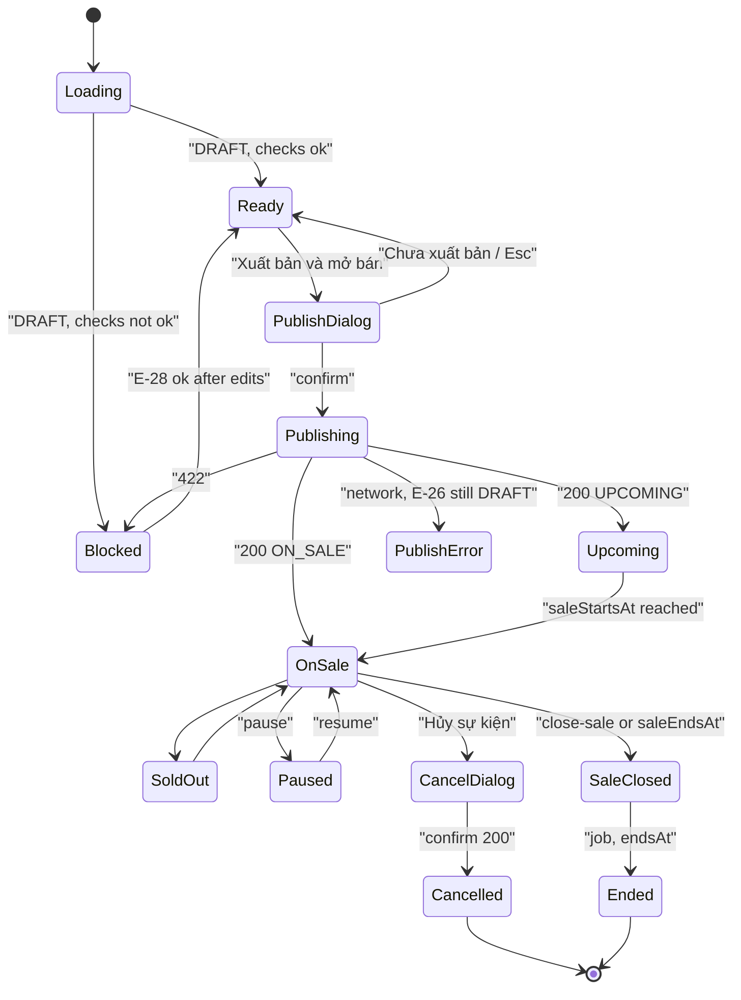

# Màn hình Studio: Xuất bản và mở bán

> Trạng thái: **Review** · Cập nhật: 2026-10-15 · DOC-59
> Phụ thuộc: SDD gốc §6.1, §13.1, [Sổ quyết định](../../00-decision-register.md) (DR-10, 12, 23, 24, 25, 27, 28, 37, 41, 44, 65, 66, 70, 71, 132, 143, 144, 184), [DOC-02](../../01-product/personas-and-journeys.md) (PS-3, PS-4), [DOC-03](../../01-product/requirements.md) (FR-02, FR-14, FR-15), [DOC-04](../../01-product/use-cases.md) (UC-09, UC-13), [DOC-06](../../02-glossary.md), [DOC-20](../../06-design/events-and-ticket-types.md) §3, §6.1–6.4, §7, [DOC-37](../../07-api/api-endpoints.md) (E-26, E-28…33, E-37), [DOC-38](../ux-principles-and-ia.md) §2.2, §3, §6.3, §8.2, §8.3, §9, [DOC-39](../design-system.md) §7.1, §7.6, §7.9, §7.11, §7.13, §7.15, §7.17, [DOC-40](../ui-states-and-copy.md) §1, §2.2, §2.3, §3.4, §4.1, [DOC-41](README.md), [DOC-58](studio-preview.md), [DOC-82](../../06-design/flows/README.md) (FL-08, FL-09, FL-10); canvas: artboard "Studio 06"
> Người dùng chính: P2-05.2 (giao diện Studio 06), P2-05.1 (đối chiếu hợp đồng E-28…33), tác giả DOC-84 (FL-08…10), DOC-60 (bước Bán vé, P5), người viết test E2E studio

Tài liệu mô tả bước cuối của studio ở `/studio/events/:eventId/publish`: danh sách điều kiện xuất bản, hộp thoại xuất bản, các nút tạm dừng, mở lại, đóng bán sớm, hủy sự kiện và khung vòng đời sự kiện. Transaction xuất bản, hủy và quy tắc trạng thái ở DOC-20 §6; payload ở DOC-37; lời gọi qua các tầng ở FL-08…10 (DOC-84). Màn này chỉ dẫn **key** chuỗi (DOC-40 §3.4). Quyết định mới khi viết tài liệu (DR-200…203) tóm tắt ở mục "Quyết định phát sinh".

## 1. Persona, use case, quyền

| | |
| --- | --- |
| Persona | PS-4 (chỉ GA, laptop; đủ cho P2), PS-3 (có sơ đồ, từ P5) |
| Use case | UC-09 (xuất bản, mở bán, tạm dừng, đóng bán sớm), UC-13 (hủy sự kiện, đơn đã thanh toán chuyển chờ hoàn tiền) |
| Yêu cầu | FR-02.2, FR-02.7…02.11, FR-14.1…14.5, FR-15.1 (dòng khóa sơ đồ) |
| Hành trình | J-3 bước 7, 10 (PS-3); J-4 bước 3–5 (PS-4) (DOC-02) |
| Luồng chi tiết | FL-08 (xuất bản), FL-09 (tạm dừng, mở lại, đóng bán sớm), FL-10 (hủy) |
| Quyền | Vai trò `ORGANIZER` và là chủ sự kiện (DOC-38 §3). Sự kiện của tổ chức khác → E-26 404 → E1 (DR-23). Chưa có hồ sơ → 403 `ORGANIZER_PROFILE_REQUIRED` → chuyển `/studio/profile`. Đã đăng nhập nhưng không có `ORGANIZER` → E3 |

## 2. URL và search params

| Route | Tham số | Quy tắc |
| --- | --- | --- |
| `/studio/events/:eventId/publish` | `eventId` | UUID; sai định dạng → E1, không gọi API; E-26 404 → E1 |

Không có search param. Màn mở được ở **mọi** trạng thái sự kiện (`DRAFT` tới `CANCELLED`); nội dung đổi theo `displayStatus` (§7). Bước này trong `StudioStepper` bấm được khi bước Xem trước đã xong hoặc sự kiện đã xuất bản (DR-70).

## 3. Wireframe

Desktop (≥ 1024 px), canvas "Studio 06", biến thể "Sẵn sàng xuất bản" (sự kiện GA "Hội thảo Kiến trúc Hệ thống", 3 loại vé, 450 vé). Hai cột: cột chính trái (trạng thái, điều kiện, thao tác), cột phải (kho vé, vòng đời) dính khi cuộn:

```
┌────────────────────────────────────────────────────────────────────────────────────────┐
│ ticket● Studio                                          vi | en     Giao Mùa Studio ▾  │
│ Sự kiện của bạn / Hội thảo Kiến trúc Hệ thống                    [Bản nháp]            │
│ (✓)Thông tin ─ (✓)Loại vé ─ (✓)Xem trước ─ (5)Xuất bản                                  │
├───────────────────────────────────────────────────────┬────────────────────────────────┤
│ XUẤT BẢN VÀ MỞ BÁN                                     │ KHO VÉ                          │
│                                                        │ 450 vé                          │
│ ┌ TRẠNG THÁI ───────────────────────────────────────┐  │ Phổ thông      300              │
│ │ Sẵn sàng xuất bản                                  │  │ Sinh viên      100              │
│ │ Bản nháp chỉ mình bạn thấy. Khi xuất bản, sự kiện  │  │ Đặt sớm         50              │
│ │ hiển thị công khai và hệ thống tạo kho 450 vé…     │  │                                 │
│ │ [ Xuất bản và mở bán ]   Xem trước lần nữa         │  │ VÒNG ĐỜI SỰ KIỆN                │
│ └────────────────────────────────────────────────────┘  │ ● Tạo bản nháp   20.10 15:00   │
│                                                        │ │ ◀ Hiện tại                   │
│ ĐIỀU KIỆN XUẤT BẢN                                     │ ○ Xuất bản       —              │
│ ✓ Thông tin            Đủ tên, địa điểm, múi giờ…  Đạt │ ○ Mở bán         05.11 10:00   │
│ ✓ Sự kiện bắt đầu ở tương lai  Bắt đầu 14.11 20:00 Đạt │ ○ Đóng bán       14.11 17:00   │
│ ✓ Có ít nhất một loại vé…  3 loại vé · sức chứa 450 Đạt│ ○ Diễn ra        14.11 20:00   │
│                                                        │ ○ Kết thúc       14.11 23:00   │
└───────────────────────────────────────────────────────┴────────────────────────────────┘
```

Desktop, biến thể "Đang mở bán" (sau xuất bản): khối trạng thái đổi, thêm hàng nút điều khiển bán và khối "Sửa sau khi mở bán"; danh sách điều kiện ẩn:

```
│ ┌ TRẠNG THÁI ─────────────────────────── [Đang mở bán] ┐                                │
│ │ Người mua đang đặt vé. Đóng bán lúc 14.11 17:00.     │                                │
│ │ [ Tạm dừng bán ]  [ Đóng bán sớm ]  Mở trang công khai ↗                              │
│ └──────────────────────────────────────────────────────┘                                │
│ SỬA SAU KHI MỞ BÁN                                                                       │
│ Tên, mô tả, ảnh sửa tự do. Đổi giờ bắt đầu…        Sửa thông tin →                       │
│ Giá mới chỉ áp dụng cho lượt giữ vé tạo sau…       Sửa loại vé →                         │
│ ─────────────────────────────────────────────────────────────                            │
│ Hủy sự kiện                                    (nút text, màu dấu đỏ, cuối cột chính)    │
```

Điện thoại 390 px (Studio dùng được dưới 1024 px trừ bước Sơ đồ, DOC-38 §6.3): một cột theo thứ tự trạng thái → điều kiện hoặc điều khiển bán → kho vé → vòng đời; `StudioStepper` xuống hàng thứ hai; nút chính rộng hết cột:

```
┌──────────────────────────────┐
│ ticket● Studio    vi|en  ☰   │
│ Hội thảo Kiến trúc…  [Bản nháp]│
│ ✓ ─ ✓ ─ ✓ ─ (5)              │
├──────────────────────────────┤
│ XUẤT BẢN VÀ MỞ BÁN           │
│ Sẵn sàng xuất bản            │
│ Bản nháp chỉ mình bạn thấy…  │
│ [   Xuất bản và mở bán    ]  │
│ Xem trước lần nữa            │
│ ĐIỀU KIỆN XUẤT BẢN           │
│ ✓ Thông tin            Đạt   │
│ ✓ Bắt đầu ở tương lai  Đạt   │
│ ✓ Loại vé              Đạt   │
│ KHO VÉ · 450 vé              │
│ VÒNG ĐỜI SỰ KIỆN             │
│ ● Tạo bản nháp  20.10 15:00  │
│ ○ Mở bán        05.11 10:00  │
└──────────────────────────────┘
```

## 4. Vùng và component

Trang là `StudioPublish` (`frontend/src/features/studio/StudioPublish.tsx`, DOC-41 §1.2).

| Vùng | Component (DOC-39 §7) | Ghi chú |
| --- | --- | --- |
| Header Studio | header chung + nhãn `studio.brand`, `AccountMenu` (§7.16) | DOC-38 §4 |
| Ngữ cảnh | breadcrumb `studio.breadcrumb.events` / tên sự kiện + `EventStatusBadge` (§7.6) theo `displayStatus` | Tên sự kiện không dịch (DR-10) |
| Thanh bước | `StudioStepper` (§7.13) | Bước Sơ đồ ẩn khi không có loại vé `SEAT`/`ZONE` (DR-70). Bước "Bán vé" và liên kết `studio.publish.toSales` **chỉ hiện từ P5** khi DOC-60 có route (DR-202) |
| Tiêu đề | `h1` `studio.publish.title` | |
| Khối trạng thái | thẻ viền `--ink`, nhãn mono `studio.publish.state.title` + tiêu đề + một câu hệ quả + hàng nút | Nội dung theo biến thể §7 |
| Nút xuất bản | `Button primary` `studio.publish.cta` | Chỉ ở `DRAFT`; vô hiệu khi E-28 `ok = false`; `loading` + `studio.publish.publishing` khi chờ E-29 |
| Nút xem trước | `Button text` `studio.publish.previewAgain` → `/studio/events/:eventId/preview` | Chỉ ở `DRAFT` |
| Điều khiển bán | `Button secondary` `studio.publish.pause` / `studio.publish.resume`; `Button secondary` `studio.publish.closeSale`; `Button text` `studio.publish.openPublic` (mở `/events/:eventId` ở tab mới) | Hiện theo bảng §6. Tạm dừng và mở lại **không** có hộp thoại (hoàn tác được); đóng bán sớm có (UXP-11) |
| Danh sách điều kiện | `ChecklistRow` (§7.11), tiêu đề `studio.publish.checks.title` | Chỉ ở `DRAFT`. 3 dòng (GA) hoặc 4 dòng (có `SEAT`/`ZONE`), nhóm 10 `key` của E-28 theo bảng dưới (DR-201) |
| Sửa sau khi mở bán | ba dòng chữ + `Button text`: `studio.publish.after.info` → `…/info`; `studio.publish.after.types` → `…/ticket-types`; `studio.publish.after.map` → `…/map` (chỉ khi có sơ đồ, từ P4) | Chỉ ở `PUBLISHED`/`PAUSED`. `mapLocked = true` (E-26, DR-37): dòng sơ đồ thay bằng `studio.publish.after.map.locked`, không có nút |
| Hủy sự kiện | `Button text` màu `--stamp-deep` `studio.publish.cancel.cta`, tách bằng đường kẻ ở cuối cột chính | Chỉ ở `PUBLISHED`/`PAUSED` (DR-28); `DRAFT` không có nút hủy |
| Kho vé | `Metric` (§7.10): nhãn `studio.publish.summary.inventory`, số `studio.preview.ticketsUnit`; một dòng mỗi loại vé: tên + sức chứa mono | GA: `gaCapacity` từ E-26. `SEAT`/`ZONE` (P5): số ghế/sức chứa khu của phiên bản sơ đồ mới nhất (DOC-57) |
| Vòng đời sự kiện | danh sách dọc có mốc, tiêu đề `studio.publish.lifecycle.title`; dấu `studio.publish.lifecycle.current` ở mốc hiện tại | Bảng mốc dưới |
| Hộp thoại | `ConfirmDialog` (§7.15) kiểu `publish`, `cancel-event`, và kiểu `close-sale` (cùng cấu trúc) | DOC-38 §8.3; §6 |
| Thông báo | `Notice` (§7.9) đặt ngay dưới `h1` | Thành công, xung đột, lỗi thao tác |

**Nhóm điều kiện** (DR-201). Canvas vẽ ba–bốn dòng; E-28 trả 10 `key` (DOC-20 §6.1). Client gộp như sau; một dòng `Đạt` khi mọi `key` của nhóm `ok`:

| Dòng | `key` của E-28 | Tên dòng | Chi tiết khi đạt | Chi tiết khi chưa đạt | Liên kết sửa |
| --- | --- | --- | --- | --- | --- |
| Thông tin | `name`, `venue`, `timezone`, `ends_at`, `sale_window` | `studio.publish.checks.info` | `studio.publish.checks.info.detail` | `studio.publish.checks.info.missing` với `{fields}` = các `studio.publish.check.<key>` chưa đạt, nối bằng `Intl.ListFormat` (`type: 'conjunction'`) | `studio.preview.editInfo` → `…/info` |
| Bắt đầu | `starts_at` | `studio.publish.checks.start` | `studio.publish.checks.start.detail` (`{time}` = `startsAt` theo DOC-40 §2.2, múi giờ sự kiện) | `studio.publish.checks.start.missing` | `studio.preview.editInfo` |
| Loại vé | `has_ticket_type`, `ticket_type_capacity` | `studio.publish.checks.ticketType` | `studio.publish.checks.ticketType.detail` (`{count}` = số loại vé, `{capacity}` = tổng sức chứa §4 "Kho vé") | `studio.publish.checks.ticketType.missing` | `studio.preview.editTypes` → `…/ticket-types` |
| Sơ đồ (chỉ khi E-28 có hai `key` này) | `seat_map_published`, `seat_map_valid` | `studio.publish.checks.map` | (không có) | chưa xuất bản: `studio.publish.checks.map.notPublished`; có lỗi: `studio.publish.checks.map.detail` (`{count}` = `params.errorCount`) | `studio.publish.checks.map.open` → `…/map`; ở P2–P3 route chưa có nên **không** hiện liên kết |

Ví dụ: E-28 trả `venue` và `sale_window` `ok: false`, còn lại đạt → dòng Thông tin "Chưa đạt", chi tiết "Cần sửa: địa điểm và khung mở bán." (`vi`) / "Needs fixing: venue and sales window." (`en`).

**Mốc vòng đời** (từ E-26; giờ theo DOC-40 §2.2, múi giờ sự kiện, hậu tố offset khi khác `PLATFORM_TIMEZONE`, DR-12):

| Mốc | Key | Giờ | Là "Hiện tại" khi |
| --- | --- | --- | --- |
| Tạo bản nháp | `studio.publish.lifecycle.draft` | `createdAt` | `DRAFT` |
| Xuất bản | `studio.publish.lifecycle.published` | `publishedAt` | `UPCOMING` |
| Mở bán | `studio.publish.lifecycle.saleStart` | `saleStartsAt` | `ON_SALE`, `SOLD_OUT`, `PAUSED` |
| Đóng bán | `studio.publish.lifecycle.saleEnd` | `saleEndsAt` (sau `close-sale` là giờ đóng thật) | `SALE_CLOSED` |
| Diễn ra | `studio.publish.lifecycle.eventStart` | `startsAt` | (không; khung bán đã đóng trước giờ diễn ra, DR-25) |
| Kết thúc | `studio.publish.lifecycle.eventEnd` | `endsAt` | `ENDED` |
| Đã hủy | `studio.publish.lifecycle.cancelled` | không có giờ | `CANCELLED`; thay mọi mốc chưa qua |

Giờ chưa đặt (bản nháp) hiện `studio.publish.lifecycle.notSet`. Mốc đã qua: chấm đặc `--ink`; mốc tới: chấm rỗng viền `--line-strong`; mốc hiện tại có chữ "Hiện tại" (không chỉ màu, UXP-08).

Khác canvas: thêm nút "Đóng bán sớm" và biến thể "Đã đóng bán" (DR-24, Owner thêm sau canvas); hộp thoại hủy bỏ câu "Chỉ hủy được khi chưa có đơn đã thanh toán" và báo số đơn sẽ chờ hoàn tiền (DR-28); bỏ dòng "Mỗi đơn tối đa 8 vé." ở khối kho vé (DR-41, DOC-38 §9). Ba khác biệt này cần thêm vào bảng DOC-38 §9.

## 5. Dữ liệu

| Dữ liệu | Endpoint | Khi nào | Ghi chú |
| --- | --- | --- | --- |
| Sự kiện | `GET /organizer/events/{eventId}` (E-26) | Vào màn; khi tab hiện lại; mỗi 30 giây khi tab hiện; sau mọi thao tác ghi | Dùng `name`, `status`, `displayStatus`, `rowVersion`, `startsAt`, `endsAt`, `saleStartsAt`, `saleEndsAt`, `timezone`, `ticketTypes[]`, `steps`, `mapLocked`, `publishedAt`, `createdAt`, `cancelledWithRefunds` (DR-203). Nhịp 30 giây để thấy `UPCOMING → ON_SALE`, `SOLD_OUT`, `ENDED` (job ≤ 60 giây) mà không cần đồng hồ client |
| Điều kiện xuất bản | `GET /organizer/events/{eventId}/publish-checks` (E-28) | Chỉ khi `status = DRAFT`: vào màn, khi tab hiện lại, sau 422 của E-29 | Người tổ chức thường sửa ở tab khác rồi quay lại |
| Số đơn cho hộp thoại hủy | `GET /organizer/events/{eventId}/sales` (E-37), dùng `orders.paid` | Khi mở hộp thoại hủy, mỗi lần mở một request (`staleTime` 0) | Có từ P2 (DR-200). Cache Redis 5 giây nên số có thể thiếu đơn vừa trả tiền trong 5 giây cuối; số thật là `refundPendingOrders` trong response E-33 |
| Xuất bản | `POST …/publish` (E-29) | Bấm nút phải của hộp thoại xuất bản | Body `{ "rowVersion": <E-26> }`; timeout client 70 giây (nginx 60 giây, DR-27) |
| Tạm dừng / mở lại / đóng bán sớm | E-30 / E-31 / E-32 | Bấm nút | Body `{}`; response `EventStateResponse` ghi đè `status`, `displayStatus`, `rowVersion` trong cache rồi gọi lại E-26 |
| Hủy | `POST …/cancel` (E-33) | Bấm nút phải của hộp thoại hủy | Body `{ "rowVersion": <E-26> }` |

Request xuất bản và response (DOC-37 E-29):

```http
POST /api/v1/organizer/events/0199b1c2-7a3e-7c40-8f11-2d5e9a6b0c34/publish
X-CSRF-Token: …

{"rowVersion":7}
```

```json
{ "eventId": "0199b1c2-7a3e-7c40-8f11-2d5e9a6b0c34", "status": "PUBLISHED", "displayStatus": "UPCOMING", "rowVersion": 8,
  "publishedAt": "2026-10-21T09:45:00Z", "inventory": { "seatUnits": 0, "pools": 3, "poolUnits": 450 } }
```

Thông báo thành công dùng `{count}` = `inventory.seatUnits + inventory.poolUnits` (450).

**Sau lỗi mạng hoặc hết timeout** của E-29 hoặc E-33: transaction có thể đã commit trước khi response mất (DOC-20 §7.3). Client **không** kết luận ngay mà gọi lại E-26 một lần: `status` đã là `PUBLISHED` (hoặc `CANCELLED`) → hiện biến thể thành công tương ứng (với hủy: câu không số `studio.publish.cancelled.body.refundNoCount` hoặc `.noRefund` theo `cancelledWithRefunds`); vẫn `DRAFT` (hoặc vẫn `PUBLISHED`/`PAUSED`) → hiện lỗi; E-26 cũng lỗi → `LoadError` của toàn màn (§7 trạng thái 16). Câu `studio.publish.error` ("Sự kiện vẫn là bản nháp, chưa có gì thay đổi") chỉ hiện sau khi E-26 xác nhận `DRAFT`.

Không có kênh real-time. Không tự thử lại lệnh ghi nào của màn này (DOC-38 §8.2: chỉ `POST` có `Idempotency-Key` mới tự thử); `rowVersion` bảo đảm bấm lại thủ công không ghi hai lần (lần sau nhận 409).

Cache TanStack Query: sau mọi lệnh ghi thành công, invalidate `['organizer-event', eventId]`, `['publish-checks', eventId]` và `['organizer-events']` (Studio 01, DOC-54).

## 6. Tương tác

Nút hiện theo `displayStatus` (E-26):

| `displayStatus` | Nút chính | Điều khiển bán | Hủy sự kiện |
| --- | --- | --- | --- |
| `DRAFT` | `studio.publish.cta`, `studio.publish.previewAgain` | — | — |
| `UPCOMING` | — | `pause`, `openPublic` (đóng bán sớm **không** hiện: E-32 409 khi chưa tới giờ mở bán, DR-24) | có |
| `ON_SALE`, `SOLD_OUT` | — | `pause`, `closeSale`, `openPublic` | có |
| `PAUSED` | — | `resume`; `closeSale` khi `saleStartsAt ≤ giờ server < saleEndsAt` (giờ server theo offset DR-66); `openPublic` | có |
| `SALE_CLOSED` | — | `pause`, `openPublic` | có |
| `ENDED` | — | `openPublic` | — |
| `CANCELLED` | — | `openPublic`, `studio.publish.toOverview` | — |

| Thao tác | Endpoint | Kết quả | Lỗi |
| --- | --- | --- | --- |
| Vào màn | E-26; E-28 nếu `DRAFT` | Biến thể theo §7 | E-26 404 → E1; 403 `ORGANIZER_PROFILE_REQUIRED` → `/studio/profile`; lỗi khác → `LoadError` |
| Bấm `studio.publish.cta` | — | Mở `ConfirmDialog` kiểu `publish`: tiêu đề `studio.publish.confirm.title` (`{name}`), các dòng `studio.publish.confirm.inventory` (số vé), `studio.publish.confirm.map` + `studio.publish.confirm.mapVersion` (chỉ khi có sơ đồ, P5), `studio.publish.confirm.saleStart` (giờ mở bán), đoạn `studio.publish.confirm.body`; nút trái `studio.publish.confirm.keep`, phải `studio.publish.cta`. Tiêu điểm vào nút trái (không hoàn tác được, DOC-38 §8.3) | — |
| Xác nhận xuất bản | E-29 | **200**: đóng hộp thoại, `Notice` `success` `studio.publish.done.notice` (`{count}`), biến thể theo `displayStatus` của response (thường `UPCOMING`; `ON_SALE` nếu giờ mở bán đã qua) | Bảng lỗi dưới |
| Bấm "Tạm dừng bán" | E-30 | 200 → biến thể `PAUSED` | 409 → `studio.publish.notice.stateConflict` + gọi lại E-26 |
| Bấm "Mở bán lại" | E-31 | 200 → biến thể theo `displayStatus` mới | 409 (đã quá `endsAt` hoặc đổi ở tab khác) → như trên |
| Bấm "Đóng bán sớm" | — | `ConfirmDialog` kiểu `close-sale`: tiêu đề `studio.publish.closeSale.title`, đoạn `studio.publish.closeSale.body`, nút trái `studio.publish.closeSale.keep`, phải `studio.publish.closeSale` (`urgent`); tiêu điểm nút trái | — |
| Xác nhận đóng bán | E-32 | 200 → `Notice` `success` `studio.publish.notice.close.success`; biến thể `SALE_CLOSED` | 409 (chưa tới giờ mở bán, đã đóng) → `stateConflict` + gọi lại E-26 |
| Bấm "Hủy sự kiện" | E-37 | Mở `ConfirmDialog` kiểu `cancel-event`: tiêu đề `studio.publish.cancel.title`; trong lúc chờ E-37: dòng `studio.publish.cancel.countLoading` và nút phải vô hiệu; `orders.paid > 0` → `studio.publish.cancel.body.refund` (`{count}` = `orders.paid`), `= 0` → `.noRefund`; nút trái `studio.publish.cancel.keep`, phải `studio.publish.cancel.confirm` (`urgent`). Tiêu điểm nút trái | E-37 lỗi → trong hộp thoại hiện `studio.publish.cancel.countError` + `common.retry`; nút phải **vô hiệu** tới khi có số (FR-14.5) |
| Xác nhận hủy | E-33 | 200 → biến thể `CANCELLED` với `studio.publish.cancelled.body.refund` (`{count}` = `refundPendingOrders`) hoặc `.noRefund` khi 0 | Bảng lỗi dưới |
| Bấm liên kết sửa của một dòng điều kiện | — | Điều hướng tới bước tương ứng (§4) | — |
| Bấm "Mở trang công khai" | — | Mở `/events/:eventId` ở tab mới (`rel="noopener"`) | — |

Lỗi của E-29, E-33 (DOC-40 §4.1):

| HTTP · `code` | Hiển thị | Hành động |
| --- | --- | --- |
| 422 `PUBLISH_PRECONDITIONS_FAILED` (`checks`, `errors`) | Đóng hộp thoại; biến thể "Chưa xuất bản được" với `studio.publish.blocked.*` | Gọi lại E-28 và E-26 rồi dựng danh sách từ E-28 (dữ liệu đã đổi sau lần kiểm trước, vd tab khác xóa loại vé) |
| 409 `STALE_EVENT_VERSION` | Hộp thoại `studio.stale.title`, `.body`, nút `studio.stale.cta` | "Tải lại" gọi lại E-26, E-28; không tự gửi lại |
| 409 `EVENT_STATE_CONFLICT` | `Notice` `warning` `studio.publish.notice.stateConflict` | Gọi lại E-26; biến thể theo trạng thái mới (vd tab khác đã xuất bản) |
| 503 `OVERLOADED` (quá `statement_timeout`, đã rollback) | `Notice` `warning` `studio.publish.error` (xuất bản) hoặc `errors.generic` (hủy) + `common.retry` | Không tự thử lại; bấm "Thử lại" mở lại hộp thoại |
| Lỗi mạng, hết 70 giây | — | Gọi lại E-26 theo §5 rồi quyết định thành công hay lỗi |
| 401 `UNAUTHENTICATED` | — | DOC-38 §8.5 (`returnTo` = URL màn này) |
| 500 | `Notice` `error` `errors.generic` + `requestId` | — |

Luồng: FL-08 (xuất bản), FL-09 (tạm dừng, mở lại, đóng bán sớm), FL-10 (hủy) ở DOC-84.

## 7. Trạng thái

Mười một biến thể của canvas "Studio 06" (khớp nhóm chuỗi `StudioXuatBan` ở DOC-40 §3.4), rồi các trạng thái tài liệu bổ sung. Biến thể chọn theo `status`/`displayStatus` của E-26 và trạng thái thao tác của màn:



| # | Trạng thái (canvas) | Điều kiện vào | Hiển thị |
| --- | --- | --- | --- |
| 1 | Sẵn sàng xuất bản (Studio 06) | `DRAFT`, E-28 `ok = true` | Khối trạng thái `studio.publish.ready.title`, `studio.publish.ready.body` (`{count}` = tổng kho vé); nút xuất bản bật; danh sách điều kiện toàn `Đạt`; badge `DRAFT` |
| 2 | Chưa xuất bản được | `DRAFT`, E-28 `ok = false` | `studio.publish.blocked.title`, `studio.publish.blocked.body` (`{count}` = số **dòng** chưa đạt ở §4); nút xuất bản vô hiệu (vẫn hiện, có `aria-describedby` trỏ tới câu `blocked.body`); dòng chưa đạt có biểu tượng chấm than, chữ `Chưa đạt` và liên kết sửa |
| 3 | Hộp thoại xuất bản | Bấm nút xuất bản ở 1 | `ConfirmDialog` `publish` (§6) |
| 4 | Đang xuất bản | Chờ E-29 | Hộp thoại giữ mở; nút phải `loading` `studio.publish.publishing`; nút trái và `Esc` vô hiệu (không hủy được request đang chạy); quá 10 giây thêm `common.loading.slow` |
| 5 | Lỗi xuất bản | E-29 lỗi mạng/hết giờ và E-26 xác nhận `DRAFT`, hoặc 503 | Đóng hộp thoại; `Notice` `error` `studio.publish.error` + `common.retry`; quay về biến thể 1 |
| 6 | Đã xuất bản, sắp mở bán | `displayStatus = UPCOMING` | Badge `UPCOMING`; `studio.publish.status.published` làm tiêu đề, `studio.publish.done.soon` (`{time}` = `saleStartsAt`); ngay sau khi xuất bản thêm `Notice` `success` `studio.publish.done.notice`; điều khiển bán theo §6; khối "Sửa sau khi mở bán" |
| 7 | Đang mở bán | `ON_SALE` | Badge `ON_SALE`; `studio.publish.onSale.body` (`{time}` = `saleEndsAt`); `pause`, `closeSale`, `openPublic`; khối "Sửa sau khi mở bán"; nút hủy |
| 8 | Tạm dừng | `PAUSED` | Badge `PAUSED`; `studio.publish.paused.title`, `studio.publish.paused.body`; `resume` là nút chính |
| 9 | Đã kết thúc | `ENDED` | Badge `ENDED`; `studio.publish.ended.body` (`{time}` = `endsAt`); chỉ `openPublic`; không khối sửa, không hủy |
| 10 | Hộp thoại hủy | Bấm "Hủy sự kiện" | `ConfirmDialog` `cancel-event` với số đơn từ E-37 (§6); trong lúc chờ E-33: nút phải `loading`, nút trái và `Esc` vô hiệu |
| 11 | Đã hủy | `CANCELLED` | Badge `CANCELLED`; ngay sau E-33: `studio.publish.cancelled.body.refund` (`{count}` = `refundPendingOrders`) hoặc `.noRefund`; mở lại màn sau đó: `.refundNoCount` khi `cancelledWithRefunds = true`, `.noRefund` khi `false` (DR-203); `openPublic`, `toOverview` |
| 12 | Hết vé *(bổ sung)* | `SOLD_OUT` | Như 7, badge `SOLD_OUT`, thêm câu `studio.publish.soldOut.body` |
| 13 | Đã đóng bán *(bổ sung, DR-24)* | `SALE_CLOSED` | Badge `SALE_CLOSED`; `studio.publish.saleClosed.body` (`{time}` = `saleEndsAt`); `pause`, `openPublic`, nút hủy; khối sửa giữ nguyên |
| 14 | Hộp thoại đóng bán sớm *(bổ sung)* | Bấm "Đóng bán sớm" | `ConfirmDialog` `close-sale` (§6) |
| 15 | Đang tải | Chờ E-26 (và E-28 nếu `DRAFT`) > 150 ms | `Skeleton` cho khối trạng thái, 3 dòng điều kiện, cột phải; dòng ẩn `studio.publish.loading` |
| 16 | Lỗi tải | E-26 lỗi (không phải 404/403), hoặc E-28 lỗi ở `DRAFT` | `LoadError`: `common.loadError.label`, `studio.publish.loadError.title`, `studio.overview.error.body`, `common.retry` |
| 17 | Trạng thái vừa đổi | 409 `EVENT_STATE_CONFLICT` từ E-29…33 | `Notice` `warning` `studio.publish.notice.stateConflict`; biến thể theo E-26 mới |
| 18 | Sửa ở nơi khác | 409 `STALE_EVENT_VERSION` từ E-29, E-33 | Hộp thoại `studio.stale.*` (DOC-38 §8.4) |
| 19 | Đang tạm dừng / mở lại | Chờ E-30/E-31 | Nút bấm `loading`; các nút điều khiển khác vô hiệu |
| 20 | Không quyền / không thấy | 403 không có `ORGANIZER`; 404 | E3; E1 (DOC-52) |
| 21 | Rỗng | Không áp dụng: sự kiện luôn có trạng thái; sự kiện không có loại vé rơi vào 2 | — |

Tiêu điểm: vào màn → `h1`; đóng hộp thoại → nút đã mở nó; sau xuất bản hoặc hủy thành công → `Notice` (tiêu đề thông báo nhận tiêu điểm vì thao tác vừa xong làm đổi toàn bộ nội dung khối trạng thái).

## 8. Microcopy

Chuỗi `vi`/`en` ở [DOC-40](../ui-states-and-copy.md) §3.4, §2.3, §4.1. Key dùng ở màn này:

| Nhóm | Key |
| --- | --- |
| Chung | `studio.brand`, `studio.breadcrumb.events`, `studio.step.*`, `studio.publish.title`, `studio.publish.state.title`, `studio.publish.status.published`, `common.eventStatus.*` |
| Bản nháp | `studio.publish.ready.title`, `.ready.body`, `.blocked.title`, `.blocked.body`, `.cta`, `.previewAgain`, `.publishing`, `.error`, `.done.notice`, `.done.soon` |
| Điều kiện | `studio.publish.checks.title`, `.checks.pass`, `.checks.fail`, `.checks.info`, `.checks.start`, `.checks.start.detail`, `.checks.ticketType`, `.checks.ticketType.detail`, `.checks.map`, `.checks.map.detail`, `.checks.map.open`, `studio.preview.editInfo`, `studio.preview.editTypes` |
| Hộp thoại xuất bản | `studio.publish.confirm.title`, `.confirm.inventory`, `.confirm.map`, `.confirm.mapVersion`, `.confirm.saleStart`, `.confirm.body`, `.confirm.keep` |
| Sau xuất bản | `studio.publish.onSale.body`, `.paused.title`, `.paused.body`, `.pause`, `.resume`, `.closeSale`, `.closeSale.body`, `.ended.body`, `.openPublic`, `.toSales` (P5), `.toOverview`, `.after.title`, `.after.info`, `.after.info.cta`, `.after.types`, `.after.types.cta`, `.after.map`, `.after.map.cta`, `.after.map.locked`, `.notice.close.success`, `.notice.stateConflict` |
| Hủy | `studio.publish.cancel.cta`, `.cancel.title`, `.cancel.body.noRefund`, `.cancel.body.refund`, `.cancel.keep`, `.cancel.confirm`, `.cancelled.body.noRefund`, `.cancelled.body.refund` |
| Cột phải | `studio.publish.summary.inventory`, `studio.preview.ticketsUnit`, `.lifecycle.title`, `.lifecycle.current` |
| Lỗi | `studio.stale.title`, `.stale.body`, `.stale.cta`, `errors.generic.*`, `studio.overview.error.body`, `common.loadError.label`, `common.loading.slow`, `common.retry` |
| **Key mới** (thêm vào DOC-40 §3.4) | `studio.publish.loading` "Đang tải trạng thái xuất bản…" / "Loading publishing status…"; `studio.publish.loadError.title` "Không tải được trạng thái sự kiện" / "Couldn't load the event status"; `studio.publish.checks.info.detail` "Đủ tên, địa điểm, múi giờ, giờ kết thúc và khung mở bán." / "Name, venue, time zone, end time and sales window are set."; `studio.publish.checks.info.missing` "Cần sửa: {fields}." / "Needs fixing: {fields}."; `studio.publish.check.name` "tên sự kiện" / "event name"; `studio.publish.check.venue` "địa điểm" / "venue"; `studio.publish.check.timezone` "múi giờ" / "time zone"; `studio.publish.check.ends_at` "giờ kết thúc" / "end time"; `studio.publish.check.sale_window` "khung mở bán" / "sales window"; `studio.publish.checks.start.missing` "Chưa đặt giờ bắt đầu, hoặc giờ bắt đầu đã qua." / "No start time is set, or it has already passed."; `studio.publish.checks.ticketType.missing` "Chưa có loại vé nào có sức chứa." / "No ticket type has any capacity yet."; `studio.publish.checks.map.notPublished` "Sơ đồ chưa có phiên bản đã xuất bản." / "The seat map has no published version yet."; `studio.publish.closeSale.title` "Đóng bán {name}?" / "Close sales for {name}?"; `studio.publish.closeSale.keep` "Tiếp tục bán" / "Keep selling"; `studio.publish.saleClosed.body` "Đã đóng bán lúc {time}. Người mua đang thanh toán dở vẫn hoàn tất được tới hết thời gian giữ vé." / "Sales closed at {time}. Buyers already checking out can finish until their hold ends."; `studio.publish.soldOut.body` "Mọi vé đang được giữ hoặc đã bán. Vé giữ mà không thanh toán sẽ tự mở bán lại." / "Every ticket is held or sold. Held tickets that aren't paid for go back on sale automatically."; `studio.publish.cancelled.body.refundNoCount` "Sự kiện không còn hiển thị để mua vé. Các đơn đã thanh toán đã chuyển sang chờ hoàn tiền; người mua đã được báo qua email." / "The event is no longer open for purchase. Paid orders moved to refund pending; buyers were notified by email."; `studio.publish.cancel.countLoading` "Đang đếm đơn đã thanh toán…" / "Counting paid orders…"; `studio.publish.cancel.countError` "Chưa đếm được số đơn đã thanh toán nên chưa hủy được. Thử lại để xem số đơn trước khi hủy." / "Couldn't count paid orders, so you can't cancel yet. Try again to see the count first."; `studio.publish.lifecycle.draft` "Tạo bản nháp" / "Draft created"; `studio.publish.lifecycle.published` "Xuất bản" / "Published"; `studio.publish.lifecycle.saleStart` "Mở bán" / "Sales open"; `studio.publish.lifecycle.saleEnd` "Đóng bán" / "Sales close"; `studio.publish.lifecycle.eventStart` "Diễn ra" / "Event starts"; `studio.publish.lifecycle.eventEnd` "Kết thúc" / "Event ends"; `studio.publish.lifecycle.cancelled` "Đã hủy" / "Cancelled"; `studio.publish.lifecycle.notSet` "Chưa đặt" / "Not set" |

`{count}` của `studio.publish.cancel.body.refund` và `studio.publish.cancelled.body.refund` ở `en` cần dạng số nhiều ICU (`{count, plural, one {# paid order} other {# paid orders}}`); DOC-40 hiện ghi "{count} paid orders", cần sửa cùng lúc thêm key mới.

## 9. Tiêu chí nghiệm thu

Tiền tố `SPB-` (đã kiểm tra chưa dùng ở `docs/`).

| ID | Given | When | Then |
| --- | --- | --- | --- |
| SPB-AC-01 | Sự kiện GA `DRAFT`, 3 loại vé sức chứa 300/100/50, E-28 `ok = true` | Mở màn | Biến thể 1; `ready.body` nói "450 vé"; 3 dòng điều kiện `Đạt`, không có dòng Sơ đồ; nút xuất bản bật |
| SPB-AC-02 | E-28: `venue`, `sale_window` `ok: false` | Mở màn | Biến thể 2; `blocked.body` "Còn 1 điều kiện chưa đạt"; dòng Thông tin "Cần sửa: địa điểm và khung mở bán."; nút xuất bản vô hiệu; liên kết "Sửa thông tin" tới `…/info` |
| SPB-AC-03 | Mọi tổ hợp 10 `key` của DOC-20 §6.1 | Dựng danh sách | Mỗi `key` thuộc đúng một dòng ở §4; không `key` nào bị bỏ (test đơn vị của hàm nhóm) |
| SPB-AC-04 | Biến thể 1 | Bấm "Xuất bản và mở bán" | Hộp thoại `publish`; tiêu đề có tên sự kiện; tiêu điểm ở "Chưa xuất bản"; `Esc` đóng, không request |
| SPB-AC-05 | Hộp thoại mở, E-26 `rowVersion = 7` | Xác nhận, E-29 trả 200 `inventory.poolUnits = 450` | Đúng một request E-29 với body `{"rowVersion":7}`; `Notice` `success` "Đã xuất bản. Kho vé đã tạo đủ 450 vé."; biến thể 6; badge `UPCOMING`; Studio 01 hiện sự kiện đã xuất bản khi quay về (cache bị invalidate) |
| SPB-AC-06 | E-29 trả 422 `PUBLISH_PRECONDITIONS_FAILED` | Xác nhận | Hộp thoại đóng; E-28 được gọi lại; biến thể 2 |
| SPB-AC-07 | E-29 mất mạng; E-26 sau đó trả `PUBLISHED` | Xác nhận | Không hiện `studio.publish.error`; biến thể 6 |
| SPB-AC-08 | E-29 mất mạng; E-26 sau đó trả `DRAFT` | Xác nhận | `Notice` `error` `studio.publish.error` + "Thử lại"; biến thể 1 |
| SPB-AC-09 | E-29 trả 409 `STALE_EVENT_VERSION` | Xác nhận | Hộp thoại `studio.stale.*`; "Tải lại" gọi E-26, E-28; không tự gửi lại E-29 |
| SPB-AC-10 | Sự kiện `ON_SALE` | Bấm "Tạm dừng bán", E-30 trả 200 | Không có hộp thoại; biến thể 8; nút "Mở bán lại" |
| SPB-AC-11 | Sự kiện `PAUSED` | Bấm "Mở bán lại", E-31 trả 409 | `Notice` `stateConflict`; E-26 được gọi lại |
| SPB-AC-12 | Sự kiện `UPCOMING` | Quan sát | **Không** có nút "Đóng bán sớm"; có "Tạm dừng bán" và "Hủy sự kiện" |
| SPB-AC-13 | Sự kiện `ON_SALE` | Bấm "Đóng bán sớm" | Hộp thoại `close-sale`, tiêu điểm "Tiếp tục bán"; xác nhận, E-32 200 → "Đã đóng bán."; biến thể 13; không có nút mở bán lại |
| SPB-AC-14 | Sự kiện `ON_SALE`, E-37 `orders.paid = 12` | Bấm "Hủy sự kiện" | Hộp thoại nêu "12 đơn đã thanh toán sẽ chuyển sang chờ hoàn tiền" (FR-14.5); tiêu điểm "Giữ sự kiện" |
| SPB-AC-15 | E-37 `orders.paid = 0` | Bấm "Hủy sự kiện" | Câu `cancel.body.noRefund` |
| SPB-AC-16 | E-37 lỗi | Bấm "Hủy sự kiện" | `cancel.countError` + "Thử lại"; nút "Hủy sự kiện" trong hộp thoại vô hiệu; bấm "Thử lại", E-37 200 → nút bật |
| SPB-AC-17 | Hộp thoại hủy với 12 đơn | Xác nhận, E-33 trả `refundPendingOrders = 13` | Biến thể 11 với "13 đơn đã thanh toán chuyển sang chờ hoàn tiền" (số của response, không phải của hộp thoại) |
| SPB-AC-18 | Sự kiện `CANCELLED`, E-26 `cancelledWithRefunds = true` | Mở lại màn | Câu `cancelled.body.refundNoCount`; không nút điều khiển bán, không nút hủy |
| SPB-AC-19 | Sự kiện `DRAFT` | Quan sát | Không có nút "Hủy sự kiện" (FR-14.1) |
| SPB-AC-20 | Sự kiện `ON_SALE`, `mapLocked = true`, có sơ đồ (P5) | Quan sát khối "Sửa sau khi mở bán" | Dòng sơ đồ là `after.map.locked`, không có nút |
| SPB-AC-21 | Sự kiện `UPCOMING`, `saleStartsAt` qua trong lúc màn mở | Đợi ≤ 30 giây | Badge đổi `ON_SALE`, nút "Đóng bán sớm" xuất hiện, không tải lại trang |
| SPB-AC-22 | Ở P2 | Quan sát thanh bước và khối trạng thái sau xuất bản | Không có bước "Bán vé", không có liên kết "Theo dõi bán vé" (DR-202) |
| SPB-AC-23 | Màn ở 390 px | Mở biến thể 1 và 7 | Một cột, không cuộn ngang; mọi nút ≥ 44 px (DOC-39) |
| SPB-AC-24 | axe-core | Biến thể 1, 2, 7, 8, 11 và ba hộp thoại | 0 vi phạm; hộp thoại có `aria-labelledby`, bẫy tiêu điểm |

## 10. Ca kiểm thử E2E

Playwright; API thật trên `make seed` với một tài khoản tổ chức và sự kiện GA nháp, `PAYMENTS_MODE=fake`; mock cho lỗi mạng và 503. Mỗi ca chạy `vi` và `en`. Ca có mock chạy được trước khi P2-05.1 xong (P2-05.2).

| ID | Tên | Bước | Kỳ vọng |
| --- | --- | --- | --- |
| SPB-01 | `studio-publish-ga` | Mở `…/publish` của sự kiện GA đủ điều kiện, xuất bản, xác nhận | SPB-AC-05; mở `/events/{id}` ở tab mới thấy "Sắp mở bán" hoặc "Đang mở bán" (DOC-43) |
| SPB-02 | `studio-publish-blocked` | Sự kiện thiếu địa điểm | SPB-AC-02; bấm "Sửa thông tin" về `…/info` |
| SPB-03 | `studio-pause-resume` | Sự kiện đang bán: tạm dừng; tài khoản người mua giữ vé → 409 `EVENT_NOT_ON_SALE`; mở bán lại; giữ vé → 201 | FR-02.9 |
| SPB-04 | `studio-close-sale` | Sự kiện đang bán: đóng bán sớm, xác nhận | SPB-AC-13; người mua giữ vé → 409; reservation tạo trước đó vẫn "Nhận vé" được (P2-05.1) |
| SPB-05 | `studio-cancel-with-paid` | Seed 3 đơn `PAID` 0 đồng; hủy | Hộp thoại nói 3 đơn; sau xác nhận biến thể 11 "3 đơn"; Mailpit có 3 email chờ hoàn tiền; Vé của tôi của người mua hiện vé `VOID` (DOC-50) |
| SPB-06 | `studio-cancel-no-paid` | Sự kiện đang bán, chưa đơn nào; hủy | Câu `noRefund` ở hộp thoại và sau khi hủy |
| SPB-07 | `studio-publish-network-lost` (mock) | E-29 bị cắt kết nối; E-26 trả `PUBLISHED` | SPB-AC-07 |
| SPB-08 | `studio-publish-stale` | Hai tab: tab B sửa tên ở Studio 02; tab A xuất bản | SPB-AC-09 |
| SPB-09 | `studio-publish-narrow` | 390 × 844, như SPB-01 | SPB-AC-23 |

## Quyết định phát sinh khi viết tài liệu này

**DR-200 · E-37 giao ở P2 để hộp thoại hủy có số đơn.** *Vấn đề:* FR-14.5 và P2-05.2 đòi hộp thoại hủy (P2) nêu số đơn sẽ chờ hoàn tiền; nguồn của số này là `orders.paid` của E-37 (DOC-37), nhưng DOC-37 §2 xếp E-37 vào P5. *Quyết định:* E-37 cài ở P2 nguyên hợp đồng (`totals`, `byTicketType`, `orders`), cache Redis 5 giây như DR-71; P5 chỉ thêm màn Studio 07 và E-38. Hộp thoại hủy gọi E-37 mỗi lần mở; số trong hộp thoại là ước lượng (trễ ≤ 5 giây), số thật là `refundPendingOrders` của E-33. *Hệ quả:* DOC-37 §2 cột Phase của E-37 thành "P2"; master plan P2-05.1 thêm E-37 vào đầu ra; P2 có key Redis `sales:event:{eventId}` (DOC-17 chốt tên ở P5, tạm dùng tên của DOC-37). *Ghi vào:* DOC-37, DOC-59, master plan §5 (P2-05.1), DOC-17.

**DR-201 · Nhóm 10 `key` của `publish-checks` thành 3–4 dòng của canvas.** *Vấn đề:* DOC-20 §6.1 và DOC-37 E-28 nói mỗi `key` có key i18n `publish.check.<key>`; DOC-40 §3.4 (theo canvas) chỉ có 4 dòng gộp (`studio.publish.checks.info`, `.start`, `.ticketType`, `.map`) và không có key nào dạng `publish.check.<key>`. *Quyết định:* client gộp theo bảng §4 (Thông tin = `name`, `venue`, `timezone`, `ends_at`, `sale_window`; Bắt đầu = `starts_at`; Loại vé = `has_ticket_type`, `ticket_type_capacity`; Sơ đồ = `seat_map_published`, `seat_map_valid`); dòng Thông tin nêu trường chưa đạt bằng key `studio.publish.check.<key>` (5 key mới, namespace `studio`). Server giữ nguyên 10 `key`. *Hệ quả:* DOC-20 §6.1 và DOC-37 E-28 sửa câu "key i18n `publish.check.<key>`" thành "giao diện gộp thành dòng theo DOC-59 §4"; DOC-40 thêm key ở §8. *Ghi vào:* DOC-20, DOC-37, DOC-40, DOC-59.

**DR-202 · Bước "Bán vé" và liên kết "Theo dõi bán vé" chỉ hiện từ P5.** *Vấn đề:* DOC-38 §2.2 và DOC-39 §7.13 thêm bước "Bán vé" ngay sau khi xuất bản, canvas Studio 06 có nút "Theo dõi bán vé"; nhưng màn Studio 07 (DOC-60) và E-38 có gate P5, nên ở P2–P4 liên kết dẫn tới route chưa có. *Quyết định:* `StudioStepper` và Studio 06 ẩn bước "Bán vé" và nút `studio.publish.toSales` khi route `…/sales` chưa đăng ký (cờ tính năng trong router, bật ở P5-xx). Ở P2 người tổ chức thấy số bán ở Studio 01 (E-24). *Hệ quả:* DOC-39 §7.13 thêm câu "bước Bán vé có từ P5"; DOC-54 không đổi. *Ghi vào:* DOC-39, DOC-59.

**DR-203 · E-26 trả `cancelledWithRefunds`.** *Vấn đề:* sau khi hủy, mở lại Studio 06 cần chọn câu `cancelled.body.refund…` hay `.noRefund`, nhưng `OrganizerEventView` (E-26) không có thông tin này; số `refundPendingOrders` chỉ có trong response E-33 và sẽ giảm khi người vận hành hoàn tiền (`REFUNDED`). *Quyết định:* `OrganizerEventView` thêm `cancelledWithRefunds` (boolean, `null` khi chưa hủy), đọc từ cột `event.cancelled_with_refunds` đã có (DR-184). Mở lại màn dùng câu không số `studio.publish.cancelled.body.refundNoCount`; câu có số chỉ hiện ngay sau E-33. *Hệ quả:* DOC-37 §7 (`OrganizerEventView`) thêm trường; không đổi DDL. *Ghi vào:* DOC-37, DOC-59.

## 11. Câu hỏi còn mở

Không có. Quyết định phát sinh: DR-200…203 (mục trên).
